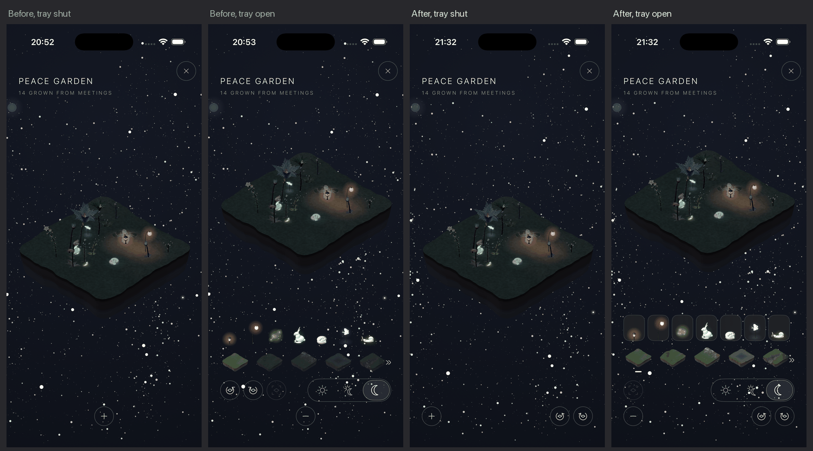
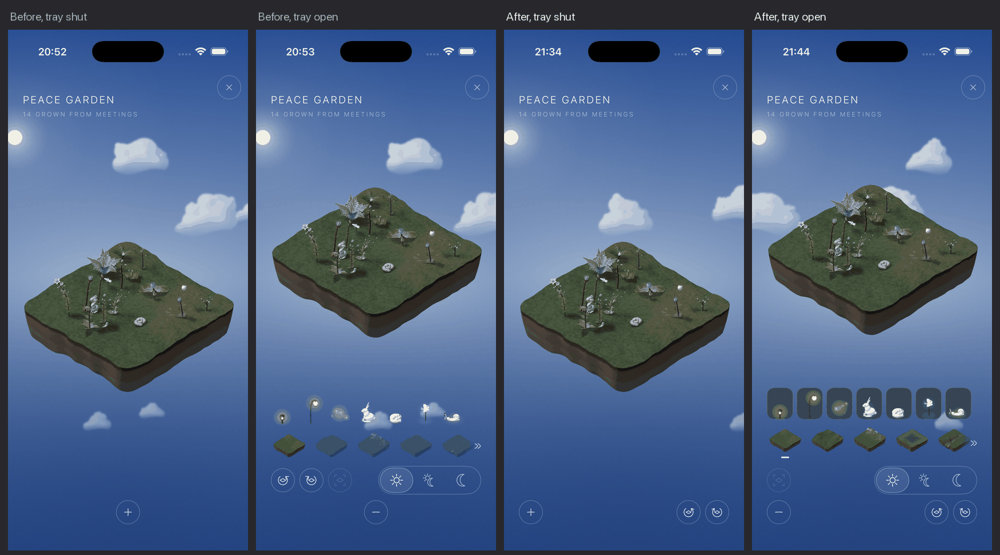
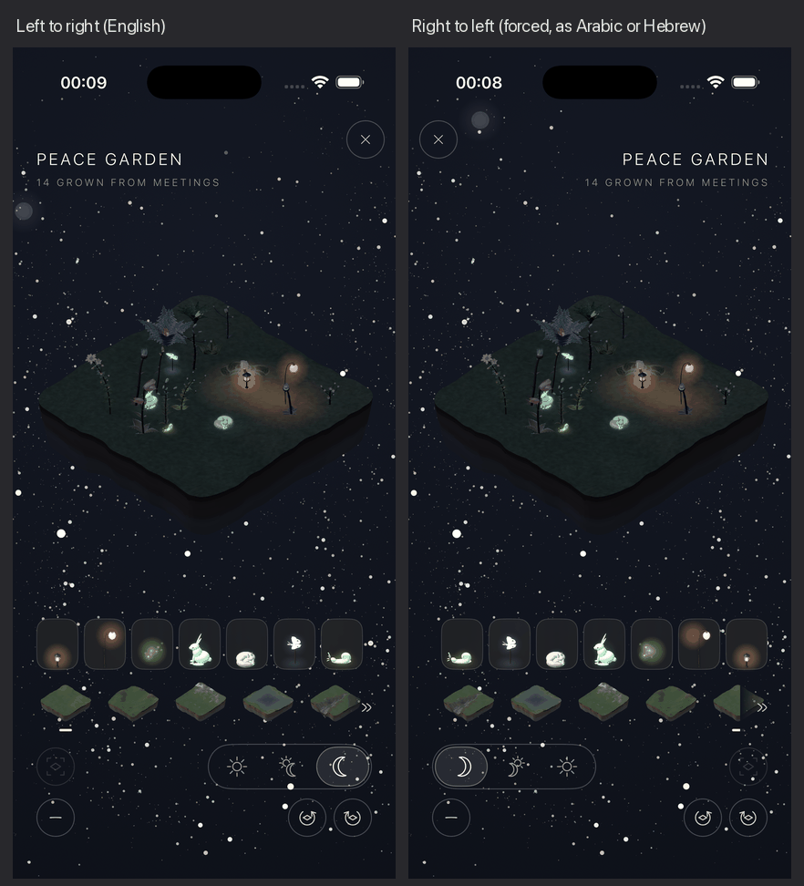
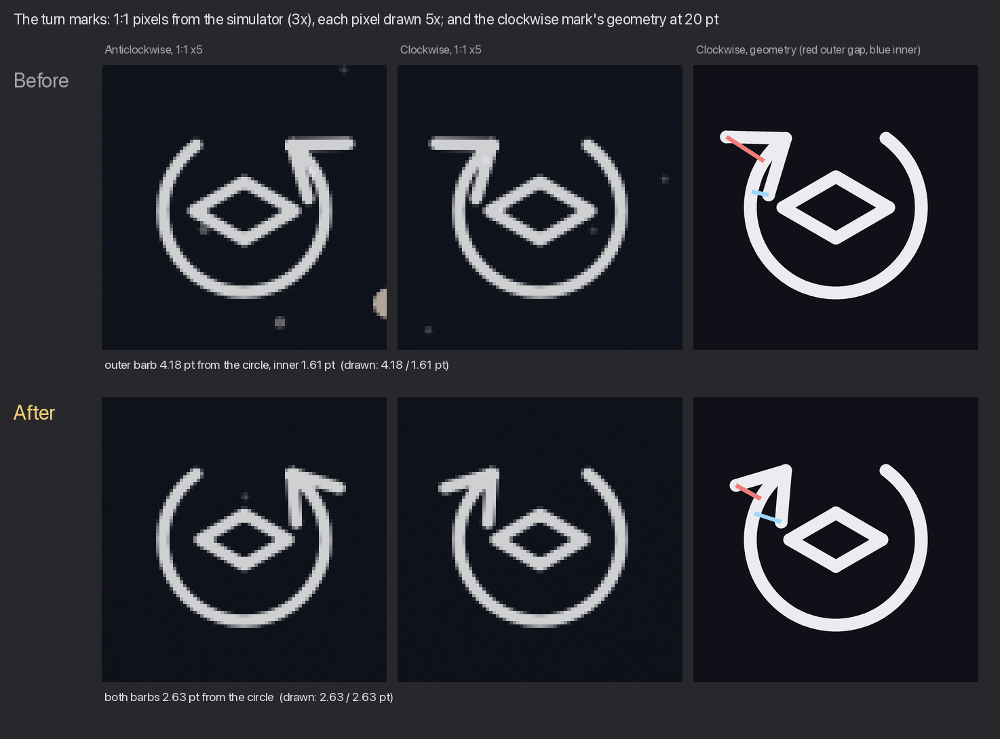
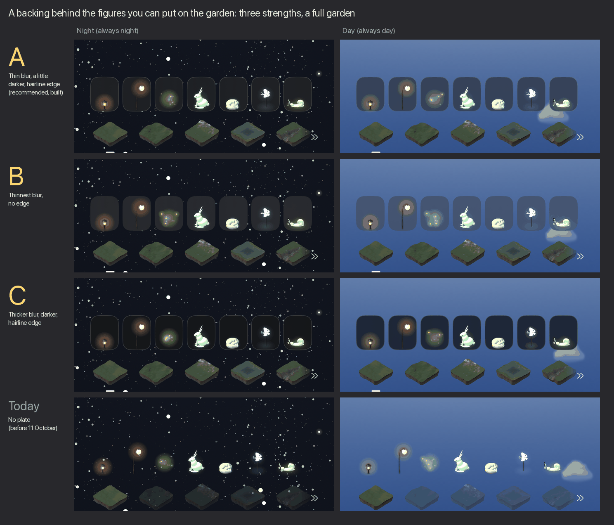
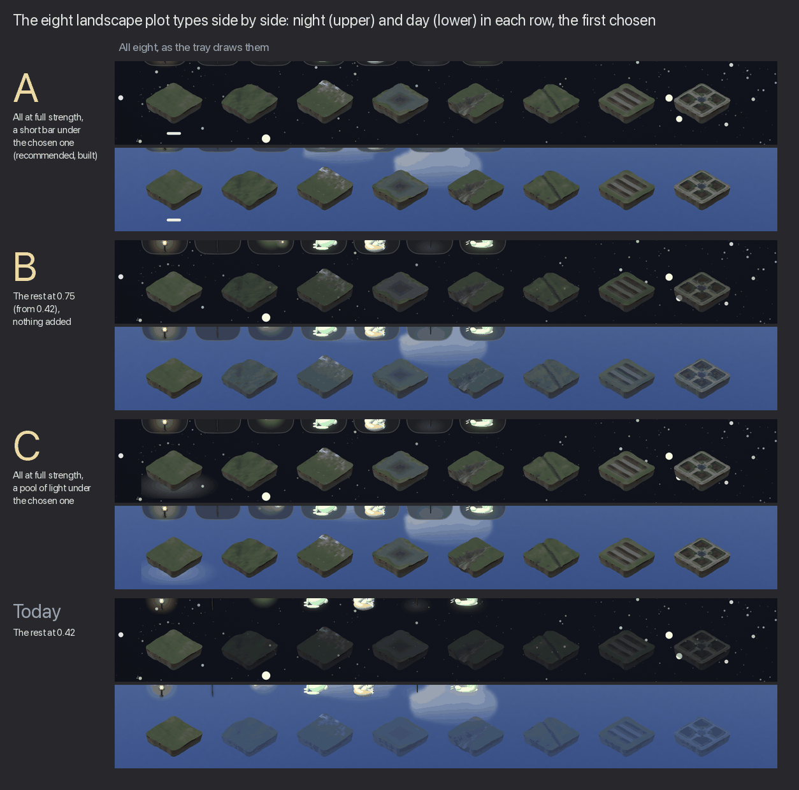

# The garden screen's controls — 11 October 2026

Marcus asked for four things on the iOS garden screen (`PlotView`): the turns always in the
bottom right and the plus in the bottom left; turn arrows whose heads sit evenly on their
circle; a backing behind the figures that can be put on the garden, so they stop passing for
stars at night; and plot types that can be told apart. All four are built, each with the
recommended option (A) as the default and the others one constant away. Branch
`claude/garden-controls-2026-10-11`; nothing is merged.

Every picture here is the real app on an iPhone Air simulator with a full garden: fourteen
plants and six figures, at night (*Always night*) and by day (*Always day*).

## Before and after

## What changed

**1. The plus bottom left, the two turns bottom right, at all times.** They used to be in the
tray, behind the plus. They now share one row at the foot with it, above the home indicator
and inside the 26 pt margin the screen already keeps, and they stay there with the tray open
(the tray opens above them). *Putting the view back* stays in the tray, beside day / clock /
night: it is disabled until the view has moved, and a faint mark in the corner of every visit
would be a control that does nothing most of the time.

**Right to left: the row does not mirror.** The app's own rule for maps is the web garden's,
*nothing mirrors under a right-to-left language, the pad included: its directions are the
screen's* (`docs/WEBSITE.md`). A turn is a screen direction, so in Arabic or Hebrew the plus is
still bottom left and anticlockwise is still left of clockwise. Checking it turned up two
existing faults, both fixed here:

- `TurnGlyph` mirrored under right to left (SwiftUI mirrors a custom `Shape` by default), so
  the button that turns the plot clockwise showed an anticlockwise arrow. It is now `.fixed`.
- The plot itself mirrored: every plant's position flipped and the ground, an image, did not.
  So plants stood on the wrong part of the terrain and a clockwise turn looked anticlockwise.
  The scene is now pinned left to right; the tray's rows still read right to left.

**2. The arrowheads.** The head was symmetric about the tangent at the tip, but the stroke
behind the tip curves inwards, so the inner barb ran close beside the stroke and the outer one
stood far off it. That is the inward kink. The head is now turned in by 14.9°, which puts both
free ends the same distance from the circle with the barbs still one length
(`sin(lean) = b(1 − √(1 − s²)) / s²`, derived in `TurnGlyph.lean`). Turned, the inner barb
pointed straight at the plot diamond's corner, so the head is an eighth shorter and the
diamond 0.54 r wide rather than 0.62 r, which gives back slightly more clear space than before.
At the tray's 20 pt mark (radius 8 pt), from
[`measure-arrowheads.py`](measure-arrowheads.py):

| | Before | After |
| --- | --- | --- |
| Barb length, outer / inner | 5.54 / 5.54 pt | 4.84 / 4.84 pt |
| Angle to the arc's tangent at the tip, outer / inner | 37.4° / 37.4° | 19.3° / 49.1° |
| Free end's distance from the circle, outer / inner | **4.18 / 1.61 pt** (2.6 : 1) | **2.63 / 2.63 pt** (1 : 1) |
| Clear space between the head and the diamond | 0.57 pt | 0.63 pt |

The angles differ after because they are measured against the tangent at the tip. Against the
line the stroke actually follows under the head, both barbs are at 34.2°.

**3. A backing behind the figures** (`FigurePlate`). Each figure in the tray stands on a
rounded plate of blurred sky. The blur removes the stars and clouds behind the figure, which
is what made them hard to tell apart, while the sky's own colour still shows through. The
plates are 12 pt apart rather than 10 pt, so they read as separate tiles.

**4. The plot types** (`GroundMarking`). The unchosen ones stood back at 0.42 opacity: dark
shapes at night, and by day the sky's blue came through all of them alike. They are now at full
strength. The chosen one is marked by a short bar beneath it. It is a bar rather than a dot
because, at night, a white dot under a landscape is one more star; this was tried first and
failed. VoiceOver now reads *selected* on the chosen one.

## Decisions for Marcus

**Question 1: how strong a backing behind the figures?**

- **A** — a thin blur, a little darker, with a hairline edge. *Recommended, built.* It reads as
  a tile at night and by day, and the figures still glow.
- **B** — the thinnest blur, no edge. The quietest: by day the plates nearly disappear into the
  sky.
- **C** — a thicker blur, darker, with the edge. The clearest, and the heaviest: seven dark
  tiles across the foot of a day sky.

Today's row, with no plate, is at the foot of the image for reference.

**Question 2: how should the chosen plot type stand out, now that the rest are brighter?**

All eight types side by side (a phone's row shows five and scrolls), night above day in each
row, the first one chosen:

- **A** — all at full strength, with a short bar under the chosen one. *Recommended, built.*
  Every type can be told apart, and the bar is clear against both skies.
- **B** — the rest at 0.75 instead of 0.42, with nothing added. Better than today, but by day
  the blue still shows through them, and the chosen one is hard to pick out.
- **C** — all at full strength, with a pool of light under the chosen one. Uses the garden's
  own way of saying *look here*, but at this size it reads as a grey smudge.

Today's row (the rest at 0.42) is at the foot of the image.

To switch to another option, change `FigurePlate.chosen` or `GroundMarking.chosen` in
`App/PeaceGarden/Views/PlotTray.swift`. In a Debug build, `-pgPlate soft|faint|firm|none` and
`-pgGrounds bar|brighter|pool|standBack` try them without a rebuild, and `-pgTray YES` opens the
tray on launch.

## Not asked, worth knowing

- **Putting the view back stayed in the tray** (see 1). If Marcus wants it beside the turns,
  it is a three-line move, and it would need its own picture first.
- **Dynamic Type does not reach this row.** Every size on the screen is a fixed
  `.system(size:)`, as `docs/CHROME-AND-SETTINGS.md` records. The tests run the row at the
  largest accessibility size to confirm that nothing moves.
- **The tray's rows scroll oddly under right to left** (`ContinuingRow`). In the forced
  right-to-left screenshot, the chosen ground at the row's start is cut by the fade. This was
  already the case before; it is out of scope here and noted for the right-to-left pass.

## Tests

`App/PeaceGardenTests/GardenControlsTests.swift`:

- **Placement**, read from the real `PlotView` in an iPhone Air-sized window through the
  accessibility tree:
  - the plus bottom left and the turns bottom right, anticlockwise first;
  - all three on one row, inside the safe area, at least 40 pt wide;
  - true with the tray shut, with it open (where *putting the view back* is above the row), and
    under right to left at the largest type.
- **The head's geometry:** equal gaps either side of the circle, equal barbs, the tip on the
  circle, clearance from the diamond, and the mark not mirroring.

`GardenControlsRenderTests` draws the whole row of grounds each way, for images like these.
It is skipped unless `PG_RENDERS` is set.
