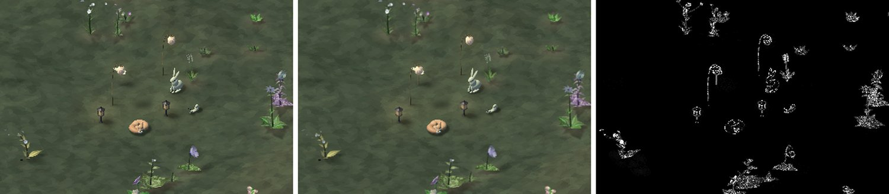
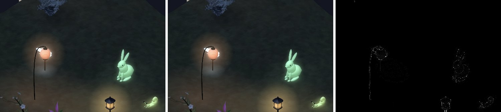

# Peace Garden app: the garden's performance, 14 October 2026

Marcus chose to fix the garden's performance now (14 October, 14A). The mass
test of 13 October (`design/mass-test-2026-10-13/app/README.md`, findings 1, 2
and 11) measured a garden that froze while it opened — 3.2 s at 100 plants,
18 s at 500 — redrew every plant on every frame of a gesture, peaked at about
8 MB a plant, passed 5 GB at 1,000 and kept 1.46 GB after closing a garden of
500. This is what it was, what changed, and the same harness run again.

## In one line each

1. **Opening no longer stops the garden**: the longest the main thread goes
   without a frame while a garden of 500 opens went from **23 s to 0.09 s**
   (100: 3.7 s to 0.06 s; unoptimised 500: 150 s to 0.26 s). The plants
   arrive one by one, photographed off the main thread: 500 is filled in
   after 9 s, where it used to be frozen for 23 and filled after 46.
2. **A gesture moves the plot and nothing on it**: a pinch at 500 plants is
   **about 10 ms** of main thread a frame with no frame dropped, and a carried
   plant about 7 ms, where each was a redraw of every plant (592 ms).
3. **Memory**: the peak at 500 went from **6.1 GB to 0.43 GB**; 1,000 peaks at
   0.29 GB and 2,000 at 0.45 GB (0.83 GB for the whole run with the
   harness's forty lights), where both were stopped past 5 GB; and **closing
   hands it back** — within 20 MB of where it started at every size, where 500
   left 1.46 GB — and nothing that climbs month after month (the caches fill
   to their bounds in the first month and stay there).
4. **The hot path** was every plant's genome rebuilt (a few hundred SHA-256s)
   two or three times on every frame — 86% of the main thread — then every
   plant photographed on the main thread, then SwiftUI walking every plant on
   every layout pass and every frame of a gesture; and a texture cache with
   no limit kept most of what was left after closing.
5. **The same look**: a garden of 14 is drawn as it was but for a few pixels on
   the figures; a garden of 100 differs on 1.2% of the plot's pixels by more
   than 8 levels in 255, on the plants' finest edges, from being taken at
   256 px/m and not 300.
6. **A regression test** in the everyday suite fails if opening a garden of
   100 holds the main thread 500 ms in one go, or if closing it keeps 150 MB.
   It fails on the branch this started from (4.7 s, 224 MB) and passes here
   (longest frame 123 ms optimised, 294 ms unoptimised; 6 MB and 3 MB kept).

## What was slow

Found with `sample` (the profiler Instruments' Time Profiler is built on)
pointed at the simulator's app process while the stress test ran, read back
with `tools/perf/sample_tree.py` (inclusive and self samples per symbol, one
thread). Three hot paths, one cache that never let go, and one too small.

1. **Every frame rebuilt every plant's genome.** `PlantRecord.genome` builds a
   `Genome` from the seed — a SHA-256 per gene, a few hundred hashes — and
   the plot asked for it two or three times a plant on every frame: once in
   the arrangement (`Arrangement.thematic`, for the plant's area), once for
   how grown it is (`record.growth(now:)`), once to hand to the plant's view.
   On a 100-plant garden with the clock moving, `Genome.init` was **86% of
   the main thread**, 0.2 ms a call; that is the whole of the 110 ms "redraw"
   of finding 2, and the 590 ms at 500.
2. **Every plant was photographed on the main thread, all at once.** Each
   plant's `.task` called `GardenSprites.sprite`, which built the mesh, made
   an `SCNView` and took `snapshot()` — 28–35 ms of main thread a picture,
   two pictures a plant, with nothing to suspend on, so a garden opening, a
   turn or a step of the clock ran every one back to back before the next
   frame. The autoreleased views and their multisampled drawables piled up
   until the block ended: the 8 MB a plant.
3. **Once those were gone, SwiftUI itself.** With nothing to recompute, a
   frame still cost 20–35 ms at 500 plants. Three causes, each found the same
   way: the plot's `ZStack(alignment: .topLeading)` asked every plant, down
   through every modifier, for alignment guides on every layout pass (a
   `Layout`'s default `explicitAlignment` does the same); the fingers' state
   lived in `PlotView`, so a pinch rebuilt the screen and SwiftUI then walked
   every plant to find nothing had changed; and the plant in hand's foot
   lived there too, so a carried plant did the same. What is left of a pinch
   is SwiftUI moving each of the plot's thousand-odd layers by itself; a
   compositing group would move one, and was tried and taken out again (see
   `PlotCamera`): drawn on the main thread whenever anything in it moves, it
   held every frame of a garden with fireflies in it.
4. **Kept after closing.** `GradientTexture`'s cache had no limit: every
   plant's baked textures, about 1.4 MB a plant, for the life of the process
   — most of the "1.3 MB a plant held" and of the 1.46 GB left after 500. The
   terrain kept up to 25 full-screen ground drawings, 14 MB each on an iPhone
   Air, one per turn and per month of the clock — the "20 MB a month" creep.
   The figures' cache held 160 pictures of up to 3 MB.
5. **The shadows' store was too small for a big garden** (16 MB, a plot of
   forty things), so it let go of sheets still on screen and made them again,
   and every sheet that arrived redrew all of them.

## What changed

Everything is in the rendering path: plant drawing, plot composition and
caches. No user-facing string, `project.yml` untouched.

| File | What |
|---|---|
| `Rendering/PlotMemo.swift` (new) | **`PlotMemo`**: genomes, the arrangement, growth (again only once the clock has moved a minute — a picture only changes at a step of growth), what has been seen, and the near-to-far order, kept until what they depend on changes. A big garden's genomes are worked out off the main thread, across the cores, and its plants stand on the plot as soon as they are known; a small one's (≤ 48) on the spot. Also **`PlotHand`**: the foot of the plant or light in hand, read only by that thing and its shadow. |
| `Rendering/GardenSprites.swift` | Pictures taken **off the main thread** on two workers, each with its own `SCNRenderer`; the two steps either side of the hour from **one mesh in one sitting**; a plant that stops waiting (the plot turned again, the garden closed) is struck off before it is begun. Rendered at **twice the drawn size, rounded up to a power of two**, never above the old 300 px/m: a garden of 14 is rendered exactly as before, a garden of 500 at 64 px/m instead of 300. Cache held **by bytes** (96 MB), emptied when the last garden closes and on a memory warning. The synchronous API stays, for the tests. |
| `Rendering/GardenCreatures.swift`, `GardenLamps.swift` | The figures likewise: off the main thread on a worker of their own, at the size drawn and the plot's zoom, cache by bytes (32 MB), emptied on close. Isolation moved from the class to what it keeps, so the models can be built off the main actor. |
| `Views/PlotView.swift` | **`PlotCamera`**, a modifier that holds the pinch, drag and lean and their gestures: its content is mounted, not rebuilt, so a gesture redraws the transform and nothing on the plot. **`Unchanged`**: the plants and the shadows are kept until their key changes (the memo's revision, the lights, who is held, the light to the 255th, turn, season, ground, view, settled zoom and pan). Each **plant's view is `Equatable`** on what it shows. A plant's pictures are asked for at the size it is seen (zoomed in, only the plants on screen ask for the finer step). Nothing inside the kept layers reads the model (`Seen`). |
| `Rendering/PlotStack.swift` (new) | **`PlotStack`**: the `ZStack(alignment: .topLeading)` the plot, the shadows and the VoiceOver layer use, without asking every child for alignment guides. |
| `Rendering/GardenShadows.swift` | Arrivals shown a few times a second, not one by one; the store sized to the garden (up to 160 MB, back to 16 on close); the shadow in hand drawn by itself; emptied on close. |
| `Rendering/GardenTerrain.swift` | The ground's drawings held by weight (64 MB, four plot drawings), emptied on close. |
| `Rendering/GradientTexture.swift` | The textures held by weight (48 MB), emptied on close. |
| `Arranging/Arrangement.swift` | `spots(…, genome:)`: the plot hands over the genomes it already has. |
| `Views/GardenVisits.swift` | A `revision`, so the memo knows when what has been seen changes. |
| `Views/PlotVoiceOver.swift` (from main) | Rides in the camera, built again only when where things stand changes (`PlotMemo.kept`, which keeps only the places, so nothing it holds holds the memo); laid out by `PlotStack`; a plant's name from the genome the plot has. Always there; past 100 plants made twelve plants a frame once the garden has filled in, in an overlay of the plot (Marcus, 14 October: 28C — see *Not resolved*, 1). |
| `App/PeaceGardenTests/GardenPerfTests.swift` (new) | The always-on regression test, and photographs to compare. |
| `App/PeaceGardenTests/MassTestStressTests.swift` | Each redraw frame's own CPU (median, max), and a phase settles only when every plant has its pictures (`GardenSprites.outstanding`). |
| `tools/perf/` (new) | `pixel_diff.py`, `compare_crop.py`, `perf_table.py`, `sample_tree.py`. |

## Measured

The mass test's own harness (`MassTestStressTests`), unchanged but for two
additions: each redraw frame's own CPU, and a phase counts as settled only
once every plant has its pictures, since a main thread at rest no longer means
a garden filled in. Same garden of genuine crosses, same iPhone Air simulator
window, same sizes. **Before** is the mass test's own evidence of 13 October
(`design/mass-test-2026-10-13/app/evidence/stress/`); **after** is the merged
branch, run today (`evidence/stress-optimised/`). Main-thread CPU and frame
intervals are the reliable numbers on a shared Mac; the walls are given where
only a wall means anything.

### Optimised Debug (`-O`)

| Plants | | Longest block opening | Filled in | Redraw, main CPU mean (median) | Turn: longest block / filled | A month on: longest block / filled | Footprint peak | After closing |
|---:|---|---:|---:|---:|---:|---:|---:|---:|
| 14 | before | 1.46 s | 1.7 s | 19.4 ms | 458 ms / 0.8 s | 426 ms / 0.8 s | 444 MB | 367 MB (from 155) |
| 14 | after | 829 ms | 0.6 s | 4.5 (4.0) ms | 59 ms / 0.6 s | 50 ms / 0.6 s | 186 MB | 52 MB (from 52) |
| 100 | before | 3.67 s | 4.5 s | 109.8 ms | 2040 ms / 3.0 s | 3266 ms / 4.1 s | 1502 MB | 611 MB (from 367) |
| 100 | after | 64 ms | 1.8 s | 4.8 (4.6) ms | 65 ms / 1.8 s | 58 ms / 1.8 s | 222 MB | 49 MB (from 52) |
| 200 | before | 10.96 s | 16.3 s | 211.6 ms | 5150 ms / 7.4 s | 4785 ms / 6.9 s | 2504 MB | 805 MB (from 155) |
| 200 | after | 105 ms | 4.1 s | 8.1 (8.1) ms | 84 ms / 4.1 s | 80 ms / 4.0 s | 250 MB | 66 MB (from 50) |
| 300 | before | 9.57 s | 13.3 s | 325.2 ms | 7625 ms / 11.3 s | 14667 ms / 20.2 s | 3846 MB | 1081 MB (from 805) |
| 300 | after | 71 ms | 5.4 s | 8.1 (8.0) ms | 65 ms / 4.8 s | 49 ms / 5.6 s | 273 MB | 64 MB (from 66) |
| 500 | before | 23.13 s | 45.7 s | 591.6 ms | 14649 ms / 31.2 s | 11988 ms / 31.1 s | 6103 MB | 1457 MB (from 611) |
| 500 | after | 89 ms | 8.9 s | 12.1 (11.9) ms | 132 ms / 8.9 s | 118 ms / 11.9 s | 426 MB | 76 MB (from 64) |
| 1000 | after | 171 ms | 21.8 s | 21.7 (21.4) ms | 202 ms / 22.1 s | 170 ms / 22.3 s | 292 MB | 70 MB (from 76) |

**1,000 and 2,000.** Before, both were stopped by the watchdog past 5 GB:
1,000 before its first frame had finished, 2,000 about 25 s into opening.

- **1,000**, the harness: first frame 79 ms, longest block opening 171 ms (the
  frame its thousand plants' views are made), filled in after 21.8 s; a turn
  202–270 ms at most and filled in again after 22 s; a month on 137–170 ms;
  **peak 292 MB**, 70 MB after closing (`evidence/stress-optimised/stress-1000.json`).
- **2,000**, the harness's garden (forty lights, a drift of fireflies among
  them): opened and filled in, and the whole process never went above
  **831 MB** (the watchdog, `evidence/stress-optimised/watchdog.log`); but
  with fireflies drifting over two thousand plants it never held still for the
  two seconds the harness waits for, so it was stopped after eleven minutes
  and wrote no result of its own. The same garden without the fireflies,
  opened, filled in and closed by `testOpenABigGarden`: first frame 147 ms,
  longest frame **317 ms** (two over 100 ms — the frame its two thousand
  plants' views are made), filled in after **44 s**, **peak 446 MB**, 47 MB
  after closing from 36 (`evidence/big-2000.json`).

### Unoptimised Debug (`-Onone`, as the everyday suite builds)

| Plants | | Longest block opening | Filled in | Redraw, main CPU mean (median) | Turn: longest block / filled | A month on: longest block / filled | Footprint peak | After closing |
|---:|---|---:|---:|---:|---:|---:|---:|---:|
| 14 | before | 5.87 s | 7.3 s | 65.5 ms | 2232 ms / 2.5 s | 2544 ms / 2.8 s | 444 MB | 389 MB (from 156) |
| 14 | after | 254 ms | 2.3 s | 8.2 (8.2) ms | 106 ms / 0.8 s | 68 ms / 0.8 s | 259 MB | 69 MB (from 62) |
| 100 | before | 31.74 s | 32.7 s | 442.1 ms | 12412 ms / 14.9 s | 13199 ms / 14.4 s | 1485 MB | 613 MB (from 389) |
| 100 | after | 328 ms | 13.9 s | 8.5 (8.4) ms | 110 ms / 11.7 s | 60 ms / 12.2 s | 263 MB | 64 MB (from 69) |
| 500 | before | 150.00 s | 157.1 s | 2258.7 ms | 58406 ms / 67.2 s | 65797 ms / 76.4 s | 6003 MB | 1452 MB (from 613) |
| 500 | after | 258 ms | 70.3 s | 16.0 (15.6) ms | 205 ms / 61.5 s | 165 ms / 58.9 s | 386 MB | 70 MB (from 64) |

### A gesture

A pinch, a pan and a carried plant change nothing the harness's clock-driven
redraw changes, so they were measured directly, with a temporary probe that
changed the pinch's scale (or the hand's foot) once a frame while the test
timed the main thread (see *Reusing it*). Main-thread CPU a frame, and the
display link's 95th percentile interval (16.7 ms is every frame on time):

| Plants | Before (the whole plot redrawn, mass test) | A pinch, after | A carried plant, after |
|---:|---:|---:|---:|
| 14 | 19 ms | 1.5 ms ¹ | – |
| 100 | 110 ms | 2.3 ms ¹ | – |
| 500 | 592 ms | **9.7 ms**, p95 16.7 ms (fireflies on the plot, at night) | **7.2 ms** ¹ |

¹ With the plot drawn as one compositing group, which was then taken out (see
*What was slow*, 3); ungrouped, the 500-plant pinch was measured A/B in one run
against it: 8.6–10.1 ms and no frame dropped, against 6.3–7.5 ms and a frame
in three dropped. The carried plant's 7.2 ms was measured grouped; ungrouped
it moves only its own layers and its shadow, and should be no slower (not
measured ungrouped).

Before the camera and the hand, with every layer already kept, a pinch at 500
plants was 20 ms and a carried plant 20 ms (`evidence/gestures/`).

## The same look

`GardenPerfTests.testPhotographGardensToCompare` photographs the whole screen
(1260 × 2736 px, an iPhone Air at 3x) of the mass test's garden at 14 and 100
plants, by day (`always`) and by night (`alwaysNight`), on a fixed date so the
season and the moon are the same; `tools/perf/pixel_diff.py` compares two of
them. *Before* is the branch this started from, *after* the work before the
merge with `main`; the merged build was photographed again and its plot is the
same as the unmerged one's to within 0.3% of pixels (what differs there is
`main`'s own header and foot). The plot's region, y 290–620 pt:

| Garden | Mean difference (0–255) | 99th percentile | Pixels differing by > 8 levels | > 16 | > 32 | Largest |
|---|---:|---:|---:|---:|---:|---:|
| 14, day | 0.01 | 0 | 0.03% | 0.01% | 0.00% | 57 |
| 14, night | 0.02 | 1 | 0.03% | 0.01% | 0.00% | 74 |
| 100, day | 0.22 | 10 | 1.23% | 0.52% | 0.10% | 149 |
| 100, night | 0.14 | 6 | 0.61% | 0.16% | 0.02% | 168 |
| two photographs *before*, for the floor | 0.00 | 0 | 0.00% | 0.00% | 0.00% | 4–152 (a few pixels of cloud) |

**A garden of 14 comes out as it was**: it is drawn at more than half the
300 px/m ceiling, so its plants are still taken at 300 px/m, and the only
differences are a handful of pixels on the figures (taken at 512 px/m rather
than 780). That also shows `SCNRenderer` off the main thread draws exactly
what `SCNView.snapshot()` did. **A garden of 100 differs on the plants' finest
edges**: each plant is now taken at 256 px/m and scaled down to the 75 it is
drawn at, where it was taken at 300 and scaled down further. Nothing moves,
nothing changes colour; the difference is where a stem one pixel wide or a
vein falls, and it is all on the plants and figures (the heat panels).

Before, after, and the difference × 8:

The whole plot: [14 day](crops/plot-14-day.jpg), [14 night](crops/plot-14-night.jpg),
[100 day](crops/plot-100-day.jpg), [100 night](crops/plot-100-night.jpg).

`GardenControlsRenderTests` and `PlotRenderTests` (both photographs to be
looked at rather than asserted) pass on the merged build and were looked at:
the row of grounds and figures, and the plot round the clock with its shadows,
lamps and figures, as before. No reference image needed changing.

## The regression test

`GardenPerfTests.testAHundredPlantGardenOpensWithoutFreezingAndLetsGoWhenClosed`,
always on, in the everyday suite. It hosts the real `PlotView` over the mass
test's garden of 100 in an iPhone Air-sized window and fails if:

- the first frame, or any frame in the eight seconds after it while the
  plants come in, takes **500 ms or more** (the garden used to take 3.2 s
  optimised and 32 s unoptimised, in one go); or
- three seconds after the window has gone, the process holds **150 MB or
  more** than it did before it opened (the mass test found 450 MB more).

Generous on purpose — the target is 100 ms at 500 plants, and a simulator on a
shared Mac can stretch a frame — so it fails on the old shape and not on a
busy afternoon. On the final build:

| Build | First frame | Longest frame | Footprint before / open / after closing |
|---|---:|---:|---:|
| Unoptimised (`-Onone`, as the suite runs) | 291 ms | 294 ms | 92 / 140 / 95 MB |
| Optimised (`-O`) | 117 ms | 123 ms | 36 / 90 / 42 MB |

On the branch this started from it fails both ways, run today optimised: a
first frame of 4.7 s, and 224 MB still held after closing
(`evidence/regression-test-on-the-starting-branch.log`).

The whole suite — 307 tests after the merge, among them `PlotTests`'
sprite tests (the plant stands on its frame's bottom edge; four turns are four
pictures), `LeafTapTests`, `CreatureTests`, `LampSheetTests`, `ShadowTests`,
`ArrangementTests` and the merge's `AccessibilityTests` — passes
unoptimised.

## Not resolved

1. **In a garden of more than a hundred plants, VoiceOver's layer is built
   only while VoiceOver or Switch Control is running.** At 500 plants it is
   500 elements made as the plants arrive — the longest block on opening went
   from 103 ms to 449 ms with it — so a big garden waits for somebody to need
   it, as the coordinator suggested. Up to a hundred it is always there
   (about 70 ms once), because Voice Control and Full Keyboard Access read
   the same elements and iOS has no public way to ask whether they are
   running, and because `AccessibilityTests` reads them with VoiceOver off.
   So **in a garden of more than a hundred, Voice Control and Full Keyboard
   Access find nothing on the plot.** Choices: **A** keep it so (as now);
   **B** always build the layer and pay the third of a second at 500 once per
   opening; **C** build it a beat after the garden has filled in, a slice a
   frame, so nothing blocks — the most work, and the right answer if big
   gardens and Voice Control are both expected.

   **Answered 14 October: C** (Marcus, 28C; `claude/app-polish-2026-10-14`).
   The layer is always built. Up to a hundred plants it is made with the plot,
   as before; past that it waits until no picture is outstanding (twice, a
   quarter of a second apart), then makes twelve plants' elements a frame,
   each twelve a view of its own that the next twelve leave alone — or at once
   in slices, without waiting, while VoiceOver or Switch Control runs. Its
   elements stand newest first, so a turn moves them rather than making them
   again, and are read far to near (`accessibilitySortPriority`). Measured
   with `testOpenABigGarden` on the Air simulator, every frame from the first
   slice to the last (`evidence/voiceover-layer/`):

   | Plants | Build | Frames | Main thread a frame: median / 90th / most | Frames over 16 ms | At rest after: 90th / most, over 16 ms |
   |---:|---|---:|---:|---:|---:|
   | 500 | optimised | 39 (0.7 s) | 2.7 / 5.4 / **6.2 ms** | 0 | 2.6 / 2.9 ms, 0 of 181 |
   | 500 | unoptimised | 44 (0.7 s) | 4.2 / 6.7 / **7.7 ms** | 0 | 2.8 / 4.1 ms, 0 of 181 |
   | 2,000 | optimised | 163 (3.9 s) | 5.8 / 47.6 / 57.3 ms | 29 | 55.0 / 65.5 ms, 20 of 124 |

   At 500 no frame of it went past 16 ms. At 2,000 a slice's own frame is
   3 ms at the start and 6 ms at the end (the medians of its four quarters);
   the frames past 16 ms are the garden's own — at rest, with nothing being
   made, it has as many (16% of frames against 18%) and longer (item 3).
   **The first try was 35 ms a slice at 2,000**, a median, because the layer
   stood beside the plot in `PlotCamera`'s stack: every slice laid the stack
   out again, and with it the plot's thousands of views (`sample`:
   `propagate_dirty` and `Subgraph::update` under the state change). In an
   overlay of the plot it is laid out in the plot's frame and the plot is not
   laid out again. A Voice Control user in a garden of 2,000 waits for it to
   fill in, 51 s on the simulator, and 4 s more.
2. **Some single frames still grow with the garden**: the frame a garden's
   plants first appear in (171 ms at 1,000, 317 ms at 2,000) and a
   quarter-turn, where every plant's view takes its new pictures' keys at
   once (132 ms at 500). Opening meets the target of about 100 ms at a
   time up to 500. Making the plants appear a few hundred a frame would
   bring both down.
3. **A garden of 2,000 does not run at 60 frames a second, even at rest,
   when fireflies are drifting in it**: sampled at rest, its main thread was
   busy about three quarters of the time, most of it SwiftUI and Core
   Animation committing a frame over some six thousand layers. 2,000 was
   asked to open without being killed, and does, at 0.45 GB (0.83 GB with
   the harness's forty lights).
4. **Carrying a plant to the edge of a zoomed-in plot**, where the plot pans
   under the finger, redraws the plants' layer on every step of the pan,
   because the settled pan decides which plants are taken at the finer size.
   Not measured; at 500 plants it will be slower than an ordinary carry.
5. **The harness's "redraw" no longer stands for a gesture.** It moves the
   clock a second a frame, which now redraws the sky every frame and, every
   seven seconds of clock, the shadows' crossfade: 15 ms a frame at 500
   plants. The pinch and carry measured by the probe (above) are the
   gestures: about 10 and 7 ms.
6. **A big garden fills in over seconds** (9 s at 500, 44 s at
   2,000): two workers, a plant at a time, far to near. Faster would be more
   workers on a phone with the cores for it, or a coarse first picture for
   everything and then the finer one.
7. **A garden's first opening in a process sometimes has one long frame**:
   the 14-plant garden, measured first, had a longest frame of 18 ms and
   33 ms in two runs and 829 ms and 1,654 ms in two others, with nothing in
   the profile of the garden's own to show for it; the runs that had it were
   on the Mac at its most loaded and swapping. Not pinned down.
8. **Simulator only, on a shared Mac** whose load average ran from 30 to over
   450 during the day; the main thread's CPU time is the reliable number,
   and the gesture probes were mostly run when the load was lowest. A device will
   differ; the shapes — nothing on the main thread that grows with the
   garden while it opens or is moved — will not.

## Reusing it

Builds and runs through the shared lock, one at a time, `-jobs 4`; scratch
simulators only (`run_tests.sh` installs over whatever is there).

    # the mass test's stress harness, optimised Debug (see the mass test's README for build.sh)
    MT_OPT=1 zsh tools/masstest/app/build.sh
    zsh tools/masstest/app/watchdog.sh <udid> watchdog.log 5000 stop-file &
    MT_DD=build/DD-MassTestUnitO zsh tools/masstest/app/run_tests.sh stress <udid> build/mt/stress build/mt/stress.clock PG_MASSTEST_SIZES=14,100,200,300,500
    python3 tools/perf/perf_table.py --before design/mass-test-2026-10-13/app/evidence/stress/stress-O --after build/mt/stress

    # photographs to compare two builds, and the comparison
    xcodebuild test-without-building … -only-testing:PeaceGardenTests/GardenPerfTests/testPhotographGardensToCompare   # with TEST_RUNNER_PG_PERF_RENDERS=<folder>
    python3 tools/perf/pixel_diff.py before/garden-100-day.png after/garden-100-day.png --region 0,290,420,330
    python3 tools/perf/compare_crop.py before/garden-100-day.png after/garden-100-day.png out.jpg 150,420,120,80

    # where the main thread goes: sample the simulator's app process while something runs
    sample <pid> 25 5 -file sample.txt
    python3 tools/perf/sample_tree.py sample.txt "Main Thread" 60 PeaceGarden

The gesture numbers came from a probe that is not in the branch: a
notification, observed by `PlotCamera` and `PlotView`, that changed the
pinch's scale or the hand's foot once a frame while the test timed the main
thread's CPU. It was never committed, being test code in the product. To
measure a gesture again: give `PlotCamera` a `@State var probe: CGFloat = 1`,
multiply it into `scale`, and set it from `.onReceive` of a notification the
test posts each frame with a value near 1; for a carried plant, set `held`
once and move `hand.plantFoot` the same way.
