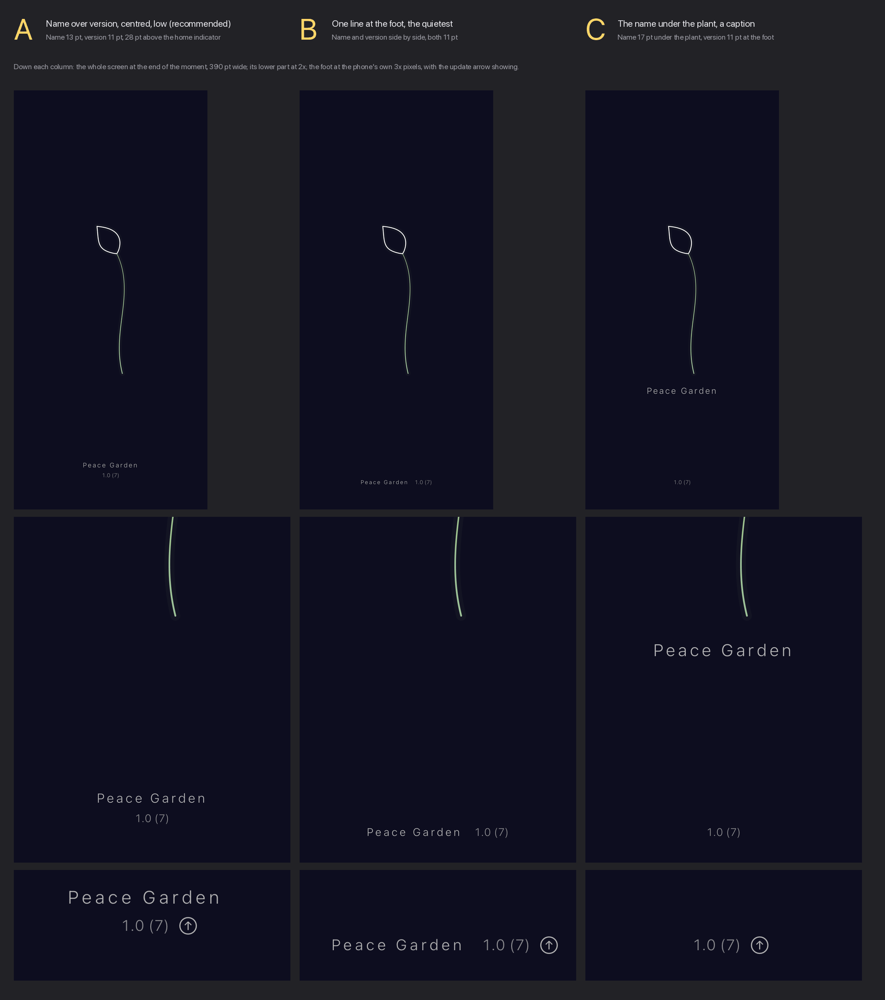

# The name and version on the launch moment, and the update check — 11 October 2026

Marcus: *"the launch moment is lovely - I think we just need to write PeaceGarden and the
version number somewhere on it, so it can check for updates if it has a network
connection."* Then, for the update check, option A: ask the App Store quietly, and show a
small up-arrow beside the version when there is something newer. Branch
`claude/launch-glyph-2026-10-11`; nothing is merged.



**Decide from [`choice.png`](choice.png).** Each column is the end of the launch moment as
the loading harness draws it (`LaunchMoment.mark` at t = 1, the launch ground, a 390 pt
phone at 3×, a 34 pt home indicator left under the foot): the whole screen, its lower part
at 2×, and the foot at the phone's own pixels with the update arrow showing.
[`update-glyph.png`](update-glyph.png) shows the recommendation's foot without the arrow,
with it, under right to left, at the largest text size and in the light appearance.

## What it says, and how

- **The name, *Peace Garden*,** is a proper noun and is written the same in every language,
  as the site's wordmark is: no key, no translation. It is set as the wordmark is set, light
  and letter-spaced by 0.18 of its size (`site.css` `.wordmark`), smaller and quieter,
  because here the plant is the picture and the name its caption.
- **The version, `1.0 (7)`,** is the bundle's: `CFBundleShortVersionString` and
  `CFBundleVersion` (`AppVersion`). Under right to left it is held in a left-to-right isolate,
  or the bidirectional algorithm would lay it out as `(7) 1.0`.
- **Colour.** The moment is on the launch ground in both appearances, so the colours are
  fixed, not the app's adaptive greys: the logo's warm white `#F4F3EF` at the chrome's two
  text levels, 0.72 for the name (9.1:1 on `#0D0D1F`) and 0.56 for the version (5.9:1). Both
  clear WCAG AA for small text, and both are quieter than the plant's leaf (17.3:1).
- **Dynamic Type** scales both, and stops at xxxLarge, where A is 1.3 times its size. A test
  draws every placement at the largest accessibility size on a 375 × 667 phone, a 390 × 844
  one and an iPad, and holds its ink below the frame the plant is drawn in and inside the
  screen.
- **VoiceOver hears one label, once**: *Peace Garden 1.0 (7)*, carried by the version; the
  name is hidden from it, and the drawing still says nothing. The update arrow, when it is
  there, is a button of its own.
- **Touch.** Any touch still ends the moment: the words take none and it falls through to
  the ground. Only the arrow keeps its own, through a 44 pt target round a glyph the size of
  a numeral; it opens the App Store and ends the moment.
- **It fades in** over the first 180 ms (`LoadingTiming.busyFade`, the app's figure for a
  thing coming in over a ground that is already there), and leaves with the plant, over
  120 ms, so it never floats over the screen being handed over to.

## Reduce Motion: no name and no version

Reduce Motion has no launch moment, only the still waiting mark, and the name and version do
not go on the still mark. The waiting mark is not a launch: it appears inside the app's own
screens whenever a request takes longer than 400 ms, so a name and version on it would be
repeated at every wait, over the screen somebody is using. A still nameplate at launch
instead would be a curtain, and Reduce Motion's rule, the suite's, is no curtain, not a
shorter one. So with Reduce Motion on there is no name, no version and no question to the App
Store, and the privacy page says so. If the version should be reachable with Reduce Motion
on, the place for it is the foot of Settings, not the waiting mark: question 2 below.

## The update check (option A, as Marcus chose)

`UpdateCheck` in `Views/Loading/UpdateCheck.swift`.

- **When.** Once a launch, started as the launch moment starts, and never waited for. The
  request may take up to 2 s, the length of the moment, because an answer after that has
  nowhere to be shown; offline, slow, refused or unreadable all end in silence. The answer is
  kept for the session.
- **What it sends.** One GET to Apple's public lookup,
  `https://itunes.apple.com/lookup?bundleId=app.peacegarden`, which names the app alone. The
  session is ephemeral, with no cookies and no cache; the two headers a phone adds on its own
  are replaced, the user agent (which names the system's version) by `PeaceGarden` and the
  preferred languages by `en`, since only two numbers are read from the answer. It honours
  Low Data Mode by not asking on a constrained network.
- **What it shows.** If the store's version is newer than the bundle's, compared as dotted
  numbers (1.10 is newer than 1.9, and 1 and 1.0 are the same), an `arrow.up.circle` SF
  Symbol appears beside the version, fading in. It opens the app's page,
  `https://apps.apple.com/app/id<the store's id>`, built from the store's numeric id rather
  than taken from the answer as a link. No results, which is what the lookup returns until
  the app is publicly released (TestFlight builds are not in it), means no arrow. Anything
  that is not dotted whole numbers is never newer.
- **No new words but one.** The arrow's VoiceOver label is one new key, *Newer version in
  the App Store*, Danish *Nyere version i App Store*; the other 41 languages are for the next
  translation round.
- **Tests and the network.** The launch moment plays in the test host too, so a test run
  asks nothing (`UpdateCheck.isHostingTests`); `UpdateCheckTests` hands the check a session
  with a stand-in for the network.
- **To see the arrow** in a debug build: `xcrun simctl launch <device> app.peacegarden
  -pgUpdateGlyph YES`. It shows the arrow without asking.

### On the privacy page

`/privacy` gains a tenth paragraph, `privacy10`, after the one on the asking, since both
happen as the app opens (`Server/.pages/privacy`, `Server/assets/js/strings.js`,
`Server/strings/da.json`). The other languages read it in English until the next
commission; `tools/strings/commission.py` and `check.py` carry it as a group of its own, as
the ninth is, so no catalogue becomes half-commissioned.

> **English.** When the app opens, it shows its name and version for a moment and asks
> Apple's App Store whether there is a newer version of Peace Garden. The question names the
> app alone, and Apple receives it from your internet address, as it does any request. If
> there is a newer version, a small arrow appears beside the version number, and touching it
> opens the App Store. With Reduce Motion on, the app opens straight into your garden,
> without the name or the question.

> **Dansk.** Når appen åbner, viser den et øjeblik sit navn og sin version og spørger Apples
> App Store, om der findes en nyere version af Peace Garden. Spørgsmålet nævner kun appen, og
> Apple modtager det fra din internetadresse, som ved enhver forespørgsel. Findes der en
> nyere version, kommer der en lille pil ved siden af versionsnummeret, og rører du ved den,
> åbner App Store. Med Reducer bevægelse slået til åbner appen direkte i din have, uden
> navnet og uden spørgsmålet.

**The privacy manifest** (`PrivacyInfo.xcprivacy`) gains a comment and no entry: the request
carries nothing about the person and reaches only Apple, so it is not collected data and not
tracking. App Store Connect's answer stays *Data Not Collected*.

## The three placements, recommendation first

| | Where | Name | Version | Foot above the home indicator |
| --- | --- | --- | --- | --- |
| **A**, recommended | stacked, centred, low | 13 pt | 11 pt, under it | 28 pt |
| **B** | one line at the foot | 11 pt | 11 pt, beside it | 14 pt |
| **C** | the name under the plant, the version at the foot | 17 pt | 11 pt | 14 pt |

Measured in the renders, on the 390 × 844 pt phone with a 34 pt home indicator; the
plant's lowest ink, its root, is at 571 pt.

| | Ink, wide × tall | Under the plant's root | Above the screen's foot | With the arrow |
| --- | --- | --- | --- | --- |
| **A** | 107 × 31 pt | 179 pt | 63 pt | the arrow hangs beside the version; nothing moves |
| **B** | 141 × 10 pt | 214 pt | 49 pt | the line grows to 162 pt |
| **C** | name 137 pt wide; version alone | 28 pt (the name) | 49 pt | beside the version, at the foot |

- **A** reads as a caption, apart from the plant and clear of the edge: the name, and the
  version under it a step quieter. At the largest text size it grows to 139 × 45 pt and stays
  153 pt under the plant's frame.
- **B** is the quietest, one line close to the home indicator. The cost: at 11 pt and
  letter-spaced the name reads as small print, and the line sits where the system's own
  furniture is.
- **C** makes a lockup, the name under the plant as the logo's lockup has it under the mark.
  It is the most present of the three and the nearest to competing with the fiddlehead, and
  the version is left alone at the foot.

`LaunchNameplate.chosen` is the switch, A until Marcus says otherwise. The loading
harness's filmstrip frames (`LoadingTests.testWriteTheLoadingFrames`) still draw the moment
without the label; they can take it once the placement is chosen.

## Decisions for Marcus

1. **Where and how big?** A, name over version, low and small (recommended) · B, one line
   at the foot · C, the name under the plant as a caption.
2. **The version with Reduce Motion on?** Nowhere, as built: no moment, no name, no question
   (recommended) · also at the foot of Settings, as `Peace Garden 1.0 (7)` with the arrow,
   which asks the App Store whenever Settings opens.

## Tests

All on the branch rebased onto `origin/main`, on a scratch iPhone Air simulator:

- `LaunchLabelTests`, 4 tests and the picture writer: the colours' contrast on the launch
  ground (9.1:1 and 5.9:1, both under the leaf's); small, the recommendation drawn, the
  wordmark's spacing; below the plant and inside the screen at the default and the largest
  accessibility text size, every placement, three screens, with the arrow showing; and the
  arrow beside the version without moving it, on its trailing side in both directions.
- `UpdateCheckTests`, 10 tests, none touching the network: dotted versions compared as
  numbers; odd versions never newer; `1.0 (7)` from the bundle and held left to right, and
  the one spoken label; the request names this app alone, with no cookies, no cache, Low
  Data Mode honoured and a 2 s limit; no results, no glyph; a newer version opens the store
  page built from its id; the same or an older version shows nothing; failure is silent;
  once a launch with the answer kept; and a test run asks nothing.
- `LoadingTests`, unchanged and passing: the moment itself is as it was.
- `tools/strings/check.py`: 42 catalogues clean, with `privacy10` its own group.

## Making the pictures again

```
TEST_RUNNER_PG_RENDER_LOADING=/some/renders xcodebuild test -project PeaceGarden.xcodeproj \
  -scheme PeaceGarden -destination 'platform=iOS Simulator,id=<a scratch simulator>' \
  -only-testing:PeaceGardenTests/LaunchLabelTests/testWriteTheLaunchLabelFrames
python3 design/launch-label-2026-10-11/make-choice.py /some/renders
```

Rendered on a scratch iPhone Air simulator, since deleted; nothing was measured on a
device.
