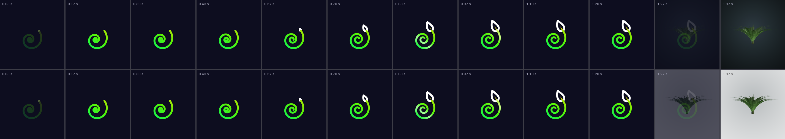
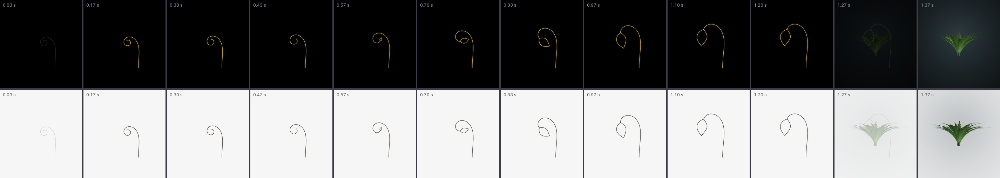
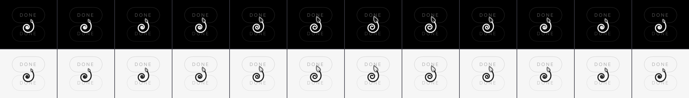
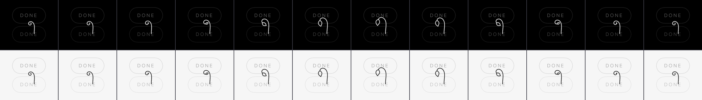
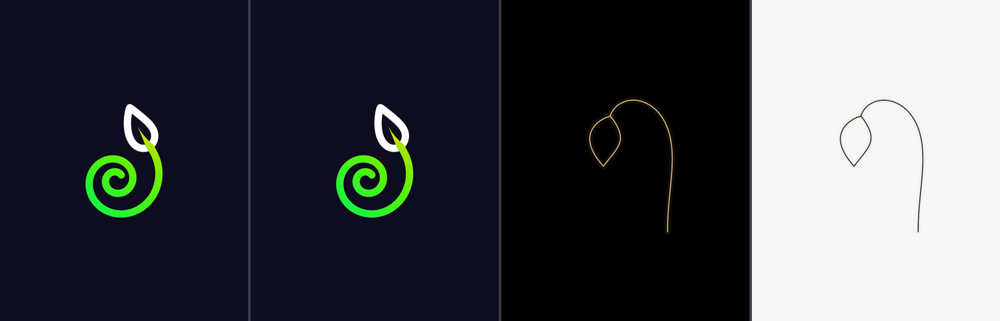
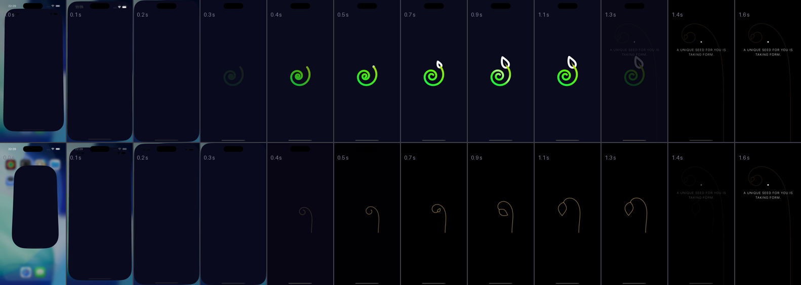

# A loading animation for Peace Garden — 10 October 2026

Two variants, drawn and wired, for Marcus to choose between from the pictures in
this folder. **Variant A is recommended.** Nothing is merged to `main`; the work is
on branch `worktree-agent-a944b9f3f00872bf1`.

| | A — the mark unwinds (recommended) | B — the fiddlehead |
| --- | --- | --- |
| What it is | The app's own mark, furled, lets go of its coil; the white bract opens like a bud; one band of light crosses it once; it rests on the exact icon drawing | The garden's own gesture, alone: a gold hairline stem lets go of its curl and a leaf opens at the tip |
| Ground | `#0D0D1F`, the suite's, in both appearances | The app's own ground, following light and dark |
| Colour | The mark's own: forest green, lime, yellow, white bract | Gold hairline (the backdrop's gold in the dark, the app's ink in the light) |
| Launch moment | 1.2 s, then the suite's 120 ms / 180 ms hand-over | 1.2 s, then the same hand-over |
| Waiting mark | The coil breathing, in the app's ink, 2.4 s | The frond breathing, in the app's ink, 2.4 s |
| Needs | A launch screen of `#0D0D1F`, to be seamless (question 3) | Nothing |
| Code | `App/PeaceGarden/Views/Loading/UnwindingMark.swift`, `UnwindingMarkGeometry.swift` | `App/PeaceGarden/Views/Loading/Fiddlehead.swift` |

## The pictures

Each is a crop of frames the shipped SwiftUI views drew (`ImageRenderer`, in
`LoadingTests.testWriteTheLoadingFrames`), at 30 frames a second, over the app's own
`StageBackdrop` and a grown plant so that the hand-over is seen against what it
hands over to. In every filmstrip the top row is the dark appearance and the bottom
row the light.

| | A | B |
| --- | --- | --- |
| **Launch, twelve frames** (the 1.2 s moment, then the hand-over) |  |  |
| **Launch, moving**, dark beside light | [`a-launch.gif`](a-launch.gif) · [`a-launch.mp4`](a-launch.mp4) | [`b-launch.gif`](b-launch.gif) · [`b-launch.mp4`](b-launch.mp4) |
| **The waiting mark, one 2.4 s breath**, over a dimmed screen |  |  |
| **The waiting mark, moving** | [`a-waiting.gif`](a-waiting.gif) · [`a-waiting.mp4`](a-waiting.mp4) | [`b-waiting.gif`](b-waiting.gif) · [`b-waiting.mp4`](b-waiting.mp4) |

**The resting frames side by side** (A dark, A light, B dark, B light) — what is on
screen just before the hand-over:



**And the real app**, not a render: a cold launch recorded on a scratch iPhone Air
simulator, from the icon being tapped. Top row A, bottom row B. The first two or
three frames are iOS's own launch zoom. Moving: [`real-launch-a.mp4`](real-launch-a.mp4),
[`real-launch-b.mp4`](real-launch-b.mp4).



## 1. What the suite does (read from the three apps; nothing in them changed)

**The pattern, in five lines.**

1. **A brand mark at rest on `#0D0D1F`, and one band of light (or one ripple) crossing it once**, then it hands over. It is the app's own icon artwork drawn in code — SwiftUI `Canvas` in UnCubed and Pfish, a web canvas in FlagFans. No Lottie, no video, no frame sequence (none of the three repositories mentions Lottie).
2. **Its phase is a function of the clock and of nothing else**, so it cannot report progress it does not have; the work behind it is started and never awaited past a ceiling; any touch ends it.
3. **Short, and once per launch:** UnCubed 0.6 s (ceiling 0.9 s), Pfish 0.6 s, FlagFans 2.0 s. The band itself travels linearly in UnCubed (`UnCubedMagic.phase`; 600 ms is `m-turn`'s *duration*, its curve is not used) and in Pfish (from its lightning flash); FlagFans eases its gust with smoothstep.
4. **The hand-over is the same in two apps:** the mark fades over 120 ms and the ground over 180 ms, started together, so the mark never floats half transparent over the screen it hands to. UnCubed and FlagFans give the system launch screen the same ground, so there is no seam; Pfish keeps its white one on purpose, because a Reduce Motion launch has no curtain.
5. **Reduce Motion gets no moment at all**, not a shorter one (UnCubed: duration 0; Pfish and FlagFans: not built). Only UnCubed has a counterpart for *user-started* waits, `BusyMark`/`CheckingRing`: four arcs "built and rebuilt", 20 pt, 2 pt stroke, 1.1 s a revolution, shown only after a 400 ms threshold, held still at phase 0 under Reduce Motion.

**Shared, and each app's own.**

| Shared by all three | UnCubed's own | Pfish's own | FlagFans's own |
| --- | --- | --- | --- |
| Ground `#0D0D1F`, flat, both appearances · the mark from the icon artwork · light crossing once · clock-only phase · any touch skips · launch work never gates · Reduce Motion means nothing | `un³` and the arc's wash · awaited launch work (restoring purchases, a 300 ms budget) · the busy ring · a table of motion tokens | A fish, two bubbles rising and a shimmer · a CloudKit check and a what's-new card behind it | 2.0 s in two beats (sheen, then a gust in the crossbar) · a wordmark, a `Checking for news…` line, an `INTERFULGENT` footer, `Tap to skip` |

**Where to read it.**

- UnCubed — `uncubed-integration/App/LaunchSplash.swift` and `LaunchSplashView.swift` (the splash, and the root's three phases), `LaunchWork.swift` (what runs behind, the 900 ms ceiling), `BrandMarkArc.swift` (`LaunchCurtain`, the 600 ms sweep), `BusyMark.swift`, `CheckingRing.swift`, `CheckingRingGeometry.swift`; `docs/design/ui-design-system.md` §6 (motion tokens; §6.4 Reduce Motion; §6.5 *no shimmer or skeleton loading*); `docs/2026-10-05-busy-and-arrows-1005.md`.
- Pfish — `pfish-ios/App/LaunchCurtainView.swift`, `Sources/TankKit/LaunchCurtain.swift` (the rules, 14 tests), `docs/launch-and-home-design.md` §2.
- FlagFans — `flagfans/src/components/LaunchSplash.tsx`; `docs/design/launch-screen/ff-launch-mockup-approved-2026-10-09.html` and its frames; `capacitor.config.ts` (the native launch image is the same ground).
- Brand — `uncubed-integration/docs/design/suite-brand.md` §3 (one ground, one stroke, one gradient, the hue allocation, Peace Garden's 140° to 60° segment) says nothing about loading. `interfulgent-hub` has no loading or motion rule. The two frames folders (`uncubed-entry-animation-frames`, `uncubed-arrowfit-frames`) are review stills for the cube entry and the arrow fit, not loading assets; they show the working method this folder follows, which is deciding from renders.

**What Peace Garden takes and what it leaves.** It takes the whole of the shared
column, and from UnCubed the waiting mark with its 400 ms threshold. It leaves the
launch work (it has none to await), FlagFans's status line and footer (words, and
forty-two translations each), and every colour that is not its own. Its own are the
drawing, the length (the app's own 1.2 s for one arrival, from
`design/Motion.dc.html`, as UnCubed took 0.6 s from its `m-turn`) and the gesture:
`design/Motion.dc.html` says *a tendril opens by its curvature falling away, and
trimming a fixed spiral reads as a line being drawn on*, so nothing is drawn on.

## 2. Where Peace Garden waits

| Wait | What is there today | Wired? |
| --- | --- | --- |
| **Launch.** `GardenModel()` reads the garden file, then `PlantStageView` builds its SceneKit view | The system's blank launch screen (the plist's `UIColorName` was empty), then the stage | **Yes**: the launch moment, an overlay with the app built underneath it (`PeaceGardenApp`) |
| **A request to the web garden** (`ShowInGardenView` asking and answering, `WildBesideView`), timeouts 8 s and 20 s | The two buttons dim to 40 % and stop answering, with nothing to say why: UnCubed's *"I could not tell whether my tap had registered"* | **Yes**: the waiting mark after 400 ms, on both screens |
| **The first draw of the garden.** `GardenSprites.sprite(…)` renders every plant through an `SCNView` snapshot on the main actor, twice per plant, and caches 120 | Plants appear as each render finishes | No. A mark per plant is the wrong shape and `PlotView` is 1,639 lines (question 4) |
| **Growing a plant's 3D scene** (`PlantSceneView`) | Black until the first frame | No. Covered at launch only |
| **An exchange between two phones** | `BreathingDot` and a sentence, while searching and while waiting for the other phone's knock | No. It has a waiting mark already and the sentence is the news (question 5) |
| **Releasing a plant** (`PlantDetailView`) | A sentence | No. Same reason |
| **First light** | `BreathingDot`, four lines arriving, `SproutingRule` | No. It is staged to be read, not a wait |

I did not measure any of these on a device, and the simulator's GPU is not the
phone's, so I have not claimed that the moment removes a hitch from the first
frame: that is the intention and it is untested.

## 3. How it is built and how it behaves

- **SwiftUI `Canvas`, no dependencies.** The drawing is a port of `tools/icon/make_icon.py` (every dial keeps its name), held to the icon by `LoadingTests.testTheMarkAtRestIsTheIconAtRest`, which pins the mouth of the bract, the tip of the coil, the stroke and the sweep's axis to the numbers in `tools/icon/icon.svg`.
- **Clock-only.** `TimelineView(.animation)` with a pose that is a pure function of elapsed time (`LoadingTiming.progress`, `UnwindingMark.pose(atMoment:)`). Nothing the app is doing can retarget it.
- **Light and dark.** A is the suite's dark ground in both, as the three suite apps are, with the mark in its own colours; its waiting form is in the app's ink, because the arc's colours belong on the mark and nowhere else (UnCubed's rule), and the mark's yellow on the app's light ground is 1.4:1. B follows the appearance, in gold on dark and the app's ink on light, because the backdrop's gold on the light ground is 1.8:1.
- **Reduce Motion.** No launch moment at all, as in all three suite apps. The waiting mark stays and holds still: A as the mark itself, B as the frond half open (`design/Motion.dc.html`: *a tendril rests half open*). The still frames are in the test output, not in this folder.
- **Organic edges.** No straight line in either drawing: `LoadingTests.testNeitherDrawingHasAStraightRun` measures the total turning in every fifth of the coil, the stem and the bract's spine. It is a test because the stem nearly failed: at the backdrop's taper it is a ruler for two thirds of its length.
- **No new words.** Nothing is said, so nothing is translated. The waiting mark is hidden from VoiceOver and has no spoken label; UnCubed says *Working it out*, which is a string, so that is left for a decision.
- **Any touch ends the launch moment**, as in the suite. A second window or a reconnecting scene is not a launch: it plays once a process.
- **The switch.** `loading.style.v1` is `unwinding` (the default, so a build of this branch shows A), `frond` or `off`. `off` is the app exactly as it was. It is a launch argument and not a setting, because a settings row is words: `xcrun simctl launch <device> app.peacegarden -loading.style.v1 frond`, or *Edit Scheme › Arguments* in Xcode.

**Known edges.**

- **A begins furled and ends at rest.** The suite's three apps begin with the mark already at rest and bring light over it. A begins from the blank launch screen, where nothing is on screen to be at rest, and arrives the way the app's motion table says things arrive. The last frame is the mark exactly, which is the suite's real requirement.
- **A sheet can cover it.** `RootView.hearNext()` may raise a sheet for a released plant at launch. A sheet is presented above the overlay, so in that one case the moment is covered rather than the sheet delayed.
- **The launch screen is cached by iOS.** Changing it is invisible until the app is deleted and the device restarted. It cost me three recordings to find that out: with the colour set, the first three still showed the white launch screen, including one after a reinstall; the fourth, after restarting the simulator, showed `#0D0D1F`.
- **Variant B with commit `19d3e7b` kept**, and the app set to its light stage (Settings, appearance), would show a dark launch screen and then a light ground. The default is the dark stage, where the step from `#0D0D1F` to black is not visible. Revert the commit with B.
- **Reduce Motion and a light stage, either variant.** No moment is shown, so with `19d3e7b` kept the launch screen is `#0D0D1F` and the app then arrives on its light ground: a dark flash that today is a white one.

## 4. Decisions for Marcus

Recommendation first in each.

1. **Which variant?** **A** (the app's own mark, in the suite's own pattern, 1.2 s) · B (the garden's fiddlehead, quieter, no launch-screen change) · neither.
2. **How long is the launch moment?** **1.2 s**, the app's own length for one arrival · 0.6 s, as UnCubed and Pfish · 2.0 s, as FlagFans. It is every launch; any touch ends it.
3. **Launch screen ground, if A.** **`#0D0D1F` in both appearances**, as UnCubed and FlagFans do; it is the separate commit `19d3e7b` (a colour set and one plist key), already on this branch · leave it system (white on a light phone, so the moment rises out of white, which I recorded). The cost of the first is in the known edges: a dark launch screen before a light stage when no moment plays.
4. **The first draw of the garden.** **A follow-up job**: hold the plot's own ground behind one waiting mark until the first row of plants is rendered, instead of plants arriving one at a time; it needs a measurement on a device first, and `PlotView` is large · never · now, in this branch.
5. **The exchange screen's `BreathingDot`.** **Leave it**: it has a sentence beside it, the sentence is the news, and the dot is the app's own heartbeat · swap it for the waiting mark · swap it only if A is chosen.
6. **Reduce Motion.** **No launch moment, still waiting mark**, as the suite does · no waiting mark either.

## 5. Making the pictures again

```
TEST_RUNNER_PG_RENDER_LOADING=/some/folder xcodebuild test -project PeaceGarden.xcodeproj \
  -scheme PeaceGarden -destination 'platform=iOS Simulator,id=<a scratch simulator>' \
  -only-testing:PeaceGardenTests/LoadingTests/testWriteTheLoadingFrames
python3 design/loading-2026-10-10/make-assets.py /some/folder
```

The seventeen tests in `LoadingTests` run in under three seconds. The real launches
were recorded with `xcrun simctl io <device> recordVideo` on a freshly created iPhone
Air, which has since been deleted; the iPhone 17 Pro was not touched.
