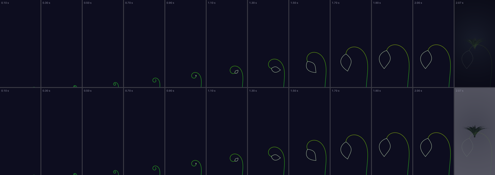
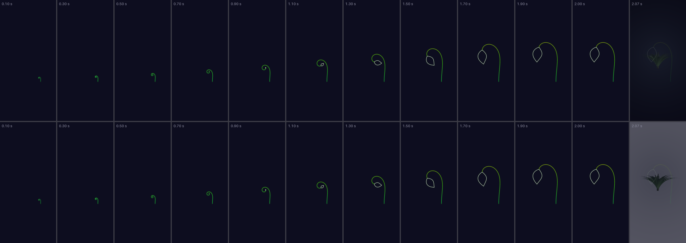
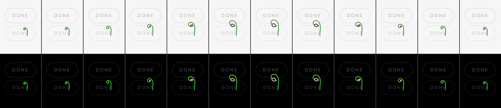
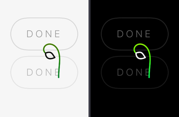

# A loading animation for Peace Garden — 10 October 2026

The app carries one loading animation: a fiddlehead that grows upward while its coil
lets go and a leaf opens at the top, in the app's own colours. Marcus chose it on
10 October 2026 from two variants, and the same day took the drawn soil out of it.
That left two ways for the stem to begin, and **both are rendered and both are
behind the style switch until he picks**; then the loser is removed. Nothing is
merged to `main`; the work is on branch `worktree-agent-a944b9f3f00872bf1`.

## Marcus's note, 10 October 2026: the soil goes

> The animation is "much better", but the drawn soil line has to go. Every plant in
> the app is one of three kinds: 3D and attached to a 3D ground; 3D and floating in
> space (the main plant view); or 2D with no soil below. A drawn ground line matches
> none of them.

The soil swell and the mound are removed entirely, from the launch moment and the
waiting mark: no line, no shade, and nothing in the palette for them. Two variants
for the launch moment:

| | Variant 1 — anchored to the screen's bottom edge | Variant 2 — a fixed point |
| --- | --- | --- |
| The stem | Enters from the very bottom edge of the screen and grows upward as it unfurls, the leaf opening as it arrives. The screen edge is the only "ground"; nothing is drawn there | Grows from a fixed point in space with nothing beneath it, like the app's 2D plants; lengthens upward from that point while the crozier uncoils |
| Where it starts | The curl is just below the edge and rises into view through it | A tiny curl at the fixed point, which does not move |
| Where it ends | A tall plant, centred across the screen, standing about half its height | The same plant, smaller, centred in the screen |
| Switch | `-loading.style.v1 edge` | `-loading.style.v1 fixed` (the default) |
| Pictures | `v1-launch-filmstrip.png`, `v1-launch.gif`, `v1-launch.mp4` | `v2-launch-filmstrip.png`, `v2-launch.gif`, `v2-launch.mp4` |

**The waiting mark uses the fixed-point drawing in both variants**, because it sits
inside a screen and cannot touch the screen's edge. Everything else stays: the
app's colours, 2.0 s, the dark launch ground, Reduce Motion giving no moment and a
still waiting mark, and the overlap of rising and unfurling.

### Recommendation: variant 2, the fixed point

1. **It is the app's own kind of plant.** The main plant view is a plant floating in
   space, centred on a black screen; the 2D plants have nothing below them. Variant 2
   is that plant, growing. The moment hands over to a stage whose plant is in the middle of the
   screen too, so the end of the animation and the start of the app are close to one
   composition.
2. **Variant 1 is the first of Marcus's three kinds in disguise.** A stem that comes
   up through the screen's bottom edge is rooted in something just off the screen: a
   ground, undrawn. It is the more dramatic of the two and uses the whole launch
   screen, but the soil objection was that a ground matches none of the app's plants,
   and an invisible one is still the one the stem is attached to.
3. **Variant 1 ends in a different place from the app.** Its plant stands on the
   bottom edge and fills the lower half of the screen; the stage's plant floats in the
   middle. The hand-over has to swap one composition for another.
4. **What variant 2 costs.** The stem's lower end is a free, round-capped end hanging
   in space. In the filmstrip it reads as a stem and not as a cut one, but it is the
   one place a drawn ground was doing something. If that bothers, variant 1 does not
   have it.

The default is variant 2 (`LoadingSwitch.fallback`; `testTheSwitchHoldsBothVariantsAndReadsALaunchArgument`
holds it). A stored `frond` or `unwinding` from earlier rounds reads as the default.

### Decision for Marcus

1. **Which launch moment?** **Variant 2, the fixed point** · variant 1, the bottom
   edge. Then the loser, and `LoadingStyle.edge` or `.fixed` with its anchor and test,
   are removed.

## What it is now

| | Launch moment | Waiting mark |
| --- | --- | --- |
| Where | Over the app as it opens (`PeaceGardenApp`), the app built underneath | Over `ShowInGardenView` and `WildBesideView` while a request is out, after 400 ms |
| Length | 2.0 s, then the suite's 120 ms (mark) and 180 ms (ground) hand-over | One breath of 2.4 s, repeating |
| Ground | `LaunchGround`, `#0D0D1F`, in both appearances | The app's own: black, or the light stage |
| Anchor | Variant 1 or 2, by the switch | The fixed point, always |
| Colour | Icon greens root to tip, white bract | Dark: the same. Light: the same three hues solved to 4.5:1, and the app's ink for the leaf |
| Motion | The stem grows while the coil lets go and the leaf opens | The tip comes up, uncurls a little, settles back |
| Reduce Motion | None at all | The mark held still, standing and half open |
| Code | `LaunchMoment.swift` | `BusyMark.swift` |

The drawing is `Fiddlehead.swift` (`Fiddlehead.Anchor` and `Fiddlehead.Placement` are
the two variants); the clocks and the switch are `LoadingTiming.swift`.

## The pictures

All are crops of frames the shipped SwiftUI views drew (`ImageRenderer`,
`LoadingTests.testWriteTheLoadingFrames`, through `LaunchMoment.mark`, the function
the app draws them with) at 30 frames a second, over the app's own `StageBackdrop`
and a grown plant, so the hand-over is seen against what it hands over to. In each
filmstrip the dark stage is above and the light stage below, and since the moment is
on the dark ground in both appearances the rows differ only at the hand-over.

**Variant 1, anchored to the bottom edge** — twelve whole screens from 0.10 s to the
hand-over at 2.07 s:



Moving: [`v1-launch.gif`](v1-launch.gif), [`v1-launch.mp4`](v1-launch.mp4).

**Variant 2, a fixed point:**



Moving: [`v2-launch.gif`](v2-launch.gif), [`v2-launch.mp4`](v2-launch.mp4).

**The waiting mark, with no soil, one 2.4 s breath over a dimmed screen: the light
appearance above, the dark below.**



Moving: [`final-waiting.gif`](final-waiting.gif), [`final-waiting.mp4`](final-waiting.mp4).
What Reduce Motion gets, light then dark:



Every image is under 450 KB. **Not re-recorded:** the real-device-style launch
recording (`soil-real-launch-*`) is of the version with the soil. The two edges are
checked by tests instead — see below — and a real launch of each variant is one
`simctl launch` with the argument named in the table.

## Decided earlier the same day, and still true

1. **The fiddlehead, in the app's colours**: the icon's three greens along the stem,
   root to tip (`tools/icon/icon.svg`, `docs/BRAND.md`), and the icon's white bract
   for the leaf. Hairline weight and no straight lines.
2. **2.0 s** for the launch moment, as FlagFans.
3. **Launch ground `#0D0D1F` in both appearances**: commit `19d3e7b` is kept, and the
   moment is drawn on the same colour, read from the same asset by name.
4. **The waiting mark** follows the app's own light and dark.
5. **The exchange screen's `BreathingDot` is left as it is.**
6. **Reduce Motion:** no launch moment, and a still waiting mark.
7. **The first garden draw is not wired** (follow-up below).
8. **It grows while it unfurls.** At the start it is a small curled tip just emerging;
   over the 2.0 s the stem lengthens upward while the crozier uncoils, so the leaf
   opens at the top as the top arrives. Rising and unfurling overlap
   (`LoadingTests.testRisingAndUnfurlingOverlap`).

### Colour, and whether it can be read

| Surface | Stem | Leaf | Measured |
| --- | --- | --- | --- |
| Launch moment, on `#0D0D1F` | `#06F556` → `#55F306` → `#DCDC06`, the icon's | `#FFFFFF`, the icon's bract | 13.0:1 for each stop (isoluminant by construction), 19.2:1 for the leaf |
| Waiting mark, dark appearance (app ground black) | the same | the same | further from black than from `#0D0D1F`, so higher |
| Waiting mark, light appearance (`Chrome.ground` 0.965) | `#03842E` → `#2E8203` → `#757503`: the same hues, lightness solved per hue to 4.5:1 by `make_icon.py`'s own method | `Chrome.ink`, 0.07 white | 4.5:1 for each stop, about 17:1 for the leaf. The icon's own yellow is 1.4:1 here |

The cost of the light palette: solved to 4.5:1 the yellow becomes an olive, which
`tools/icon/make_icon.py`'s notes record at 9.1:1 too.

## Follow-up: the first garden draw — measure on a device first

Not wired, as decided. `GardenSprites.sprite(…)` renders every plant through an
`SCNView` snapshot on the main actor, twice per plant, and caches 120, so on the
first open of the garden plants arrive as each render finishes. Holding the plot's
own ground behind one waiting mark until the first row is in is the likely shape of
a fix, but nobody has measured how long the first draw actually takes. The
simulator's GPU is not the phone's, so a figure from it would mislead. Measure on a
device first, then decide whether it needs a mark at all, or a faster draw.

## 1. What the suite does (read from the three apps; nothing in them changed)

**The pattern, in five lines.**

1. **A brand mark at rest on `#0D0D1F`, and one band of light (or one ripple) crossing it once**, then it hands over. It is the app's own icon artwork drawn in code — SwiftUI `Canvas` in UnCubed and Pfish, a web canvas in FlagFans. No Lottie, no video, no frame sequence (none of the three repositories mentions Lottie).
2. **Its phase is a function of the clock and of nothing else**, so it cannot report progress it does not have; the work behind it is started and never awaited past a ceiling; any touch ends it.
3. **Short, and once per launch:** UnCubed 0.6 s (ceiling 0.9 s), Pfish 0.6 s, FlagFans 2.0 s. The band itself travels linearly in UnCubed (`UnCubedMagic.phase`; 600 ms is `m-turn`'s *duration*, its curve is not used) and in Pfish (from its lightning flash); FlagFans eases its gust with smoothstep.
4. **The hand-over is the same in two apps:** the mark fades over 120 ms and the ground over 180 ms, started together, so the mark never floats half transparent over the screen it hands to. UnCubed and FlagFans give the system launch screen the same ground, so there is no seam; Pfish keeps its white one on purpose, because a Reduce Motion launch has no curtain.
5. **Reduce Motion gets no moment at all**, not a shorter one (UnCubed: duration 0; Pfish and FlagFans: not built). Only UnCubed has a counterpart for *user-started* waits, `BusyMark`/`CheckingRing`: four arcs "built and rebuilt", 20 pt, 2 pt stroke, 1.1 s a revolution, shown only after a 400 ms threshold, held still at phase 0 under Reduce Motion.

**Shared, and each app's own.**

| Shared by all three | UnCubed's own | Pfish's own | FlagFans's own |
| --- | --- | --- | --- |
| Ground `#0D0D1F`, flat, both appearances · the mark from the icon artwork · light crossing once · clock-only phase · any touch skips · launch work never gates · Reduce Motion means nothing | `un³` and the arc's wash · awaited launch work (restoring purchases, a 300 ms budget) · the busy ring · a table of motion tokens | A fish, two bubbles rising and a shimmer · a CloudKit check and a what's-new card behind it | 2.0 s in two beats (sheen, then a gust in the crossbar) · a wordmark, a `Checking for news…` line, an `INTERFULGENT` footer, `Tap to skip` |

**Where to read it.**

- UnCubed — `uncubed-integration/App/LaunchSplash.swift` and `LaunchSplashView.swift` (the splash, and the root's three phases), `LaunchWork.swift` (what runs behind, the 900 ms ceiling), `BrandMarkArc.swift` (`LaunchCurtain`, the 600 ms sweep), `BusyMark.swift`, `CheckingRing.swift`, `CheckingRingGeometry.swift`; `docs/design/ui-design-system.md` §6 (motion tokens; §6.4 Reduce Motion; §6.5 *no shimmer or skeleton loading*); `docs/2026-10-05-busy-and-arrows-1005.md`.
- Pfish — `pfish-ios/App/LaunchCurtainView.swift`, `Sources/TankKit/LaunchCurtain.swift` (the rules, 14 tests), `docs/launch-and-home-design.md` §2.
- FlagFans — `flagfans/src/components/LaunchSplash.tsx`; `docs/design/launch-screen/ff-launch-mockup-approved-2026-10-09.html` and its frames; `capacitor.config.ts` (the native launch image is the same ground).
- Brand — `uncubed-integration/docs/design/suite-brand.md` §3 (one ground, one stroke, one gradient, the hue allocation, Peace Garden's 140° to 60° segment) says nothing about loading. `interfulgent-hub` has no loading or motion rule. The two frames folders (`uncubed-entry-animation-frames`, `uncubed-arrowfit-frames`) are review stills for the cube entry and the arrow fit, not loading assets; they show the working method this folder follows, which is deciding from renders.

**What Peace Garden takes and what it leaves.** It takes the shared column — the
dark ground that is also the launch screen's, the hand-over, clock-only phase, any
touch skips, Reduce Motion meaning nothing — and from UnCubed the waiting mark with
its 400 ms threshold. It leaves the launch work (it has none to await), FlagFans's
status line and footer (words, and forty-two translations each), and the band of
light: the suite's mark is crossed by light because it is a finished mark at rest,
and this one is something opening, which the app's motion document says is the
gesture (*a tendril opens by its curvature falling away; trimming a fixed spiral
reads as a line being drawn on*). The length is FlagFans's, by choice.

## 2. Where Peace Garden waits

| Wait | What is there today | Wired? |
| --- | --- | --- |
| **Launch.** `GardenModel()` reads the garden file, then `PlantStageView` builds its SceneKit view | The system's blank launch screen (the plist's `UIColorName` was empty), then the stage | **Yes**: the launch moment, an overlay with the app built underneath it (`PeaceGardenApp`) |
| **A request to the web garden** (`ShowInGardenView` asking and answering, `WildBesideView`), timeouts 8 s and 20 s | The two buttons dim to 40 % and stop answering, with nothing to say why: UnCubed's *"I could not tell whether my tap had registered"* | **Yes**: the waiting mark after 400 ms, on both screens |
| **The first draw of the garden** | Plants appear as each render finishes | No: follow-up, measure on a device first |
| **Growing a plant's 3D scene** (`PlantSceneView`) | Black until the first frame | No. Covered at launch only |
| **An exchange between two phones** | `BreathingDot` and a sentence | No, left as it is, as decided |
| **Releasing a plant** (`PlantDetailView`) | A sentence | No. Same reason |
| **First light** | `BreathingDot`, four lines arriving, `SproutingRule` | No. It is staged to be read, not a wait |

I did not measure any of these on a device, so I have not claimed that the moment
removes a hitch from the first frame: that is the intention and it is untested.

## 3. How it is built and how it behaves

- **SwiftUI `Canvas`, no dependencies.** `Fiddlehead.figure(open:rise:)` builds the stem and the leaf as points, from `Frond.path(in:)`'s own construction, and `Fiddlehead.draw` strokes them: the stem in a vertical gradient of the icon's greens, the leaf in white. Nothing else is drawn.
- **Two anchors, one drawing.** `Fiddlehead.Placement` says where the 100 × 130 frame lands on the canvas. `bottomEdge` puts the root below the screen's bottom edge by exactly the height the curl has when it begins, so at the first moment the tip is at the edge and nothing is on screen, and scales the plant's whole travel to at most 86 % of the width or 95 % of the height, which on a phone is the width. `fixedPoint` centres the whole travel in its frame, so the root is a point that does not move. `testTheEdgeAnchorEntersFromTheBottomOfTheScreen` and `testTheFixedAnchorIsAPointThatDoesNotMove` hold them to it, on three screen sizes for the edge.
- **Nothing is drawn beneath it.** `testNothingIsDrawnBelowTheStem` asks the pixels: in the fixed variant nothing is lit below the root, and in the edge variant the last rows of the screen hold a few pixels of stem and not a line across.
- **Grows, not trims.** The stem's arc length is `emerging + (1 − emerging) × rise` of its full length, with `emerging = 0.16`: unlike the backdrop's frond, whose length never changes, this one is longer the higher it has risen, and its root never moves. The turning is measured along it as a fraction of itself, so a short stem is a small tight crozier and a long one is a large open one.
- **Clock-only.** `TimelineView(.animation)` with a pose that is a pure function of elapsed time (`LoadingTiming.progress`, `Fiddlehead.pose(atMoment:)`). Nothing the app is doing can retarget it.
- **Reduce Motion.** No launch moment at all, as in all three suite apps. The waiting mark stays and holds still: standing, and a tendril half open (`design/Motion.dc.html`: *a tendril rests half open*).
- **Organic edges.** No straight line anywhere. `testTheStemHasNoStraightRun` measures the total turning in every fifth of the stem at nine risings and openings. The stem is a test because it nearly failed: at the backdrop's taper it is a ruler for two thirds of its length.
- **No new words.** Nothing is said, so nothing is translated. The waiting mark is hidden from VoiceOver and has no spoken label; UnCubed says *Working it out*, which is a string.
- **Any touch ends the launch moment**, as in the suite. A second window or a reconnecting scene is not a launch: it plays once a process.
- **The switch.** `loading.style.v1` is `fixed` (the default), `edge` or `off`; `off` is the app exactly as it was. It is a launch argument and not a setting, because a settings row is words: `xcrun simctl launch <device> app.peacegarden -loading.style.v1 edge`, or *Edit Scheme › Arguments* in Xcode.

**Known edges.**

- **Variant 1 on a phone with a rounded display and a home indicator.** The root is exactly at the bottom of the screen's full height, so the stem enters at the physical edge, behind the home indicator's strip. The geometry is held by tests on three screen sizes; it has not been seen on a device.
- **Variant 2's free end.** The stem's lower end is a round-capped hairline end in mid-air. It is the price of having nothing beneath it.
- **A sheet can cover it.** `RootView.hearNext()` may raise a sheet for a released plant at launch. A sheet is presented above the overlay, so in that one case the moment is covered rather than the sheet delayed.
- **The launch screen is cached by iOS.** Changing it is invisible until the app is deleted and the device restarted. On a real phone: delete the app and restart it.
- **Reduce Motion and the light stage.** No moment is shown, so with the launch screen at `#0D0D1F` the app then arrives on its light ground: a dark flash where today it is a white one. The default stage is dark, where it is invisible.
- **The leaf is small on the waiting mark.** At 40 pt it is a white or inked lens a few points across: it reads as a leaf in the filmstrip, but it is the first thing to go at a smaller size.

## Earlier pictures, kept for the record

| Set | What it shows | Files |
| --- | --- | --- |
| `soil-` | The final version before Marcus's note: the fiddlehead growing out of a drawn swell of soil, 2.0 s. Superseded; the code that drew it is at commit `73e7d06` | `soil-launch-filmstrip.png`, `soil-launch.gif`, `soil-launch.mp4`, `soil-waiting-filmstrip.png`, `soil-waiting.gif`, `soil-waiting.mp4`, `soil-waiting-reduce-motion.png`, `soil-real-launch-filmstrip.png`, `soil-real-launch.mp4` (a real cold launch on a scratch iPhone Air) |
| `a-`, `b-`, `real-launch-` | The first round, 1.2 s: variant A (the app's own mark unwinding, crossed by one band of light; removed at Marcus's decision) and variant B in gold with no ground. The code is at commit `ada12fe`, and `make-assets-first-round.py` rebuilt them | `a-launch-filmstrip.png`, `a-launch.gif`, `a-launch.mp4`, `a-waiting-*`, `b-launch-*`, `b-waiting-*`, `compare-resting-frames.png`, `real-launch-filmstrip.png`, `real-launch-a.mp4`, `real-launch-b.mp4` |

## Making the pictures again

```
TEST_RUNNER_PG_RENDER_LOADING=/some/folder xcodebuild test -project PeaceGarden.xcodeproj \
  -scheme PeaceGarden -destination 'platform=iOS Simulator,id=<a scratch simulator>' \
  -only-testing:PeaceGardenTests/LoadingTests/testWriteTheLoadingFrames
python3 design/loading-2026-10-10/make-assets.py /some/folder
```

The twenty-four tests in `LoadingTests` run in under four seconds, and `LoadingTests`
alone was run for this round, as asked. The pictures were rendered on a scratch
iPhone Air simulator, which has been deleted; the iPhone 17 Pro was not touched.
