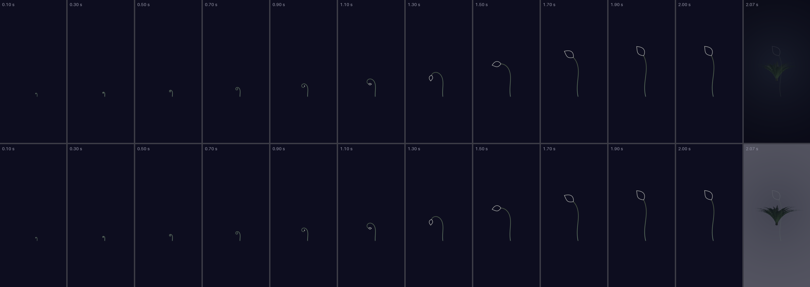

# The loading animation in the logo's colours, with the leaf lifted — 11 October 2026

The fiddlehead now wears the logo Marcus chose this morning (D-suite,
[`design/logo-2026-10-11/`](../logo-2026-10-11/README.md)), and its leaf finishes lifted,
up and a little outward, as the logo's tall frond carries its leaf. On 10 October it ended
hanging head-down from the hook, which is the downward-facing flower that round one's logo
was turned down for. Reduce Motion's still is now a small standing sprout with its leaf
lifted. Duration, ground, hand-over, the waiting mark's breath, Reduce Motion's rules and
the exchange screen's `BreathingDot` are as they were. Branch
`claude/fiddlehead-2026-10-11`; nothing is merged.

**Decided — Marcus, 11 October 2026: everything as recommended, and the still lifted too.**
The answers are recorded under each question at the end.



The launch moment, 2.0 s on `#0D0D1F`, over the dark stage (above) and the light stage
(below). Moving: [`launch.gif`](launch.gif), [`launch.mp4`](launch.mp4). The plant it ends
on, at a phone's own 3× pixels: [`final-frame.png`](final-frame.png). Against 10 October:
[`before-after.png`](before-after.png).

## What changed

**1. The colours**, exactly as the logo's §6 asks (`Fiddlehead.Palette`):

| | 10 October | 11 October | Measured |
| --- | --- | --- | --- |
| `onDark.stem` (launch moment; waiting mark, dark) | `#06F556` `#55F306` `#DCDC06` | `#9CC29E` `#9DC386` `#A9C263`, sage → moss → green-gold | 9.71, 9.67, 9.67:1 on `#0D0D1F` |
| `onDark.leaf` | `#FFFFFF` | `#F4F3EF`, warm white | 17.3:1 |
| `onLight.stem` (waiting mark, light) | `#03842E` `#2E8203` `#757503` | `#397E3D` `#467D25` `#60781E` | 4.60, 4.61, 4.63:1 on `#F6F6F6` |
| `onLight.leaf` | the app's ink | unchanged | 17.4:1 |
| `onDark.halo` | 0.07 | **0.04** | see §3 |

**2. The leaf lifts at the end.** A third beat, `lift`, runs from 40 % to 98 % of the
moment (0.8 s to 1.96 s) and moves the stem towards a second heading (`Fiddlehead.Lift`):
it turns the curl's way by only 0.2 rad, so the tip and the leaf on its tangent end
pointing up and **36° outward** (the logo's leaf is 35°), and the whole stem leans 0.25 rad
that way about its root, so the plant stands over its root. The lift begins while the curl
is still letting go, so the leaf, carried round by the uncoiling, keeps turning the same way
until it points up: it never turns back, and smoothstep brings it to a standstill with the
last 40 ms still. Tests hold all three (`testTheLeafEndsLiftedUpAndOutward`,
`testTheLeafSettlesWithoutABounce`).

- **A standing stem is nearly a ruler.** To pass the no-straight-lines test (every fifth of
  the stem turns more than 2°) its sway is 0.4 rad, twice the curl's, and of the same sign,
  so on the way from curled to standing the base is never straight for a frame. The gentlest
  fifth now turns 2.4°. The cost is a visible S in the standing stem.
- **The launch moment is fitted to its own travel** (`Fiddlehead.Fit.moment`) and centres
  the plant it ends on, because the hook it passes through reaches out to the leaf's side.
  The root now sits a little right of centre and does not move.
- **The waiting mark's breath does not lift.** It is a curl breathing, keeps its 10 October
  fit and size, and only changes colour ([`waiting-filmstrip.png`](waiting-filmstrip.png),
  [`waiting.gif`](waiting.gif)).
- **Reduce Motion's still lifts** (question 6). It was a tendril half open (open 0.7, rise
  0.8), which at rest hung the leaf from the hook for the whole wait. It is now the plant the
  moment ends on at half its growth (`Fiddlehead.still`: open 0.9, rise 0.5, lift 1): the
  leaf 36° outward, inside the waiting mark's own fit, on the same root as the breath, with
  nothing below it and no straight run. [`reduce-motion.png`](reduce-motion.png) shows it in
  light and dark; [`still-before-after.png`](still-before-after.png) against 10 October.

**3. The halo: 0.04.** It is a flat band 10 pt wide, not a blur. In the old neon at 0.07 it
read as a glow; in the pale sage at 0.07 it reads as a grey casing, a second edge round the
line. At 0.04 it is about six levels from the ground in each channel and stays a softness the
line sits in. With none, the line is crisp and closest to the logo, which has no halo.
[`option-halo.png`](option-halo.png) shows all three at 1:1.

**4. Two dials**, launch arguments like `loading.style.v1`, defaulting to Marcus's choice
(questions 2 and 3); the other values stay so they can be seen beside it:

| Dial | Values | Default |
| --- | --- | --- |
| `loading.stem.v1` | `tapered` (root to tip, ending at 0.6 of the root's width: 1.8 → 1.1 pt at launch, 1.5 → 0.9 pt on the waiting mark) · `even` (10 October's hairline) | `tapered` |
| `loading.leaf.v1` | `outline` (stroked, as the logo's) · `filled` | `outline` |

`xcrun simctl launch <device> app.peacegarden -loading.stem.v1 even -loading.leaf.v1 filled`

## The options, recommendation first

**The stem: tapered** ([`option-stem.png`](option-stem.png)). The coil thins as it turns in
and the stem thins under the leaf, so the leaf reads a little heavier, which is what Marcus
asked of the logo. It is gentle: the difference shows in the 1:1 crop of the end and hardly
at 40 pt, where the tip is 0.9 pt, three pixels on a 3× phone, and still reads as a line.
The logo's §8 keeps its 16–48 px drawings untapered because there the thin end nears one
device pixel (`suite-brand.md` §3.2a); the waiting mark's thinnest point is 2.7 device pixels
on a 3× phone and 1.8 on a 2× one, so it stays tapered. Its width runs linearly from root
to tip, where the logo's eases on a smoothstep; at a hairline the two cannot be told apart.

**The leaf: outline** ([`option-leaf.png`](option-leaf.png)). It is the logo's leaf. Honestly
at 40 pt: at the top of the breath, and in the still, the waiting mark's leaf is about 12 by
7 pt, measured in the renders, and the outline leaves a hole about 4 pt across at its widest.
It reads as an outlined leaf at a phone's 3× in both appearances, and a 2× screen would still
have 8 pixels of hole. At the bottom of the breath it is a bud a point across, a dot in either
dress. Filled reads more solidly at 40 pt, but at launch size it is a large white shape that
outweighs the hairline stem and is not the logo.

## What it costs, shown

- **The curl is drawn smaller.** The lifted plant stands about 1.5 times as tall as
  10 October's arch, and the frame is fitted to the tallest pose, so until the end everything
  is drawn at 65 % of 10 October's size. The plant it ends on is the same height on the screen
  as before (about 296 pt on a 390 pt phone). [`question-frame.png`](question-frame.png) also
  shows a frame 1.8 times as tall as it is wide, which brings the curl back to 78 % and makes
  the final plant about 355 pt. Marcus kept the frame as built (question 5).
- **Quieter.** The logo's sage at 9.7:1 and saturation 0.33 has much less presence on the dark
  ground than the neon at 13:1 and 0.95, and the tapered hairline is finer still. That is the
  logo's calm, chosen; `before-after.png` shows how much.
- **The lift is the moment's largest movement.** Between 1.0 s and 1.9 s the leaf swings from
  hanging, through sideways, to up. It turns one way and settles, but it is a second movement
  you see, in `launch.gif`.

## Decisions for Marcus

All six answered by Marcus on 11 October 2026, each as recommended.

1. **The lifted ending, leaf 36° off upright on a standing stem with a gentle S?** Yes, as
   built (recommended) · lift it less, the leaf ending further out, about 50° · keep 10
   October's hanging leaf.
   **Decided, 11 October 2026: yes, as built.**
2. **The stem?** Tapered to 0.6 (recommended) · even, as on 10 October · tapered further, to
   0.45.
   **Decided, 11 October 2026: tapered to 0.6** (`loading.stem.v1` defaults to `tapered`).
3. **The leaf?** Outline, as the logo's (recommended) · filled.
   **Decided, 11 October 2026: outline** (`loading.leaf.v1` defaults to `outline`).
4. **The halo?** 0.04 (recommended) · none · 0.07, as on 10 October.
   **Decided, 11 October 2026: 0.04.**
5. **The launch frame, now that the plant ends taller?** As built, half as tall again as it is
   wide, so the final plant is 10 October's height on screen (recommended) · 1.8 times as tall,
   so the curl is bigger and the final plant larger.
   **Decided, 11 October 2026: as built**, half as tall again as it is wide. The 1.8 render
   stays in `question-frame.png` for the record.
6. **Reduce Motion's still: the leaf hangs from the hook, as on 10 October. Lift it too?**
   Yes, a small standing sprout with its leaf up (recommended) · keep the half-open tendril.
   **Decided, 11 October 2026: yes, lifted.** Built as `Fiddlehead.still` (open 0.9, rise 0.5,
   lift 1), the pose drawn in the question's render; see
   [`reduce-motion.png`](reduce-motion.png) and [`still-before-after.png`](still-before-after.png).

## Tests

`LoadingTests` alone, 27 tests, all pass, on the branch rebased onto `origin/main` (23
before; the four new ones are the moment's own fit, the lifted leaf, the settle without a
bounce, and the two dials). Pins changed knowingly: the launch stops from 13.0:1 to 9.7:1
and pinned to the logo's hex values; the leaf from more than 18:1 to more than 17:1; the
light stops pinned to the logo's light-ground values at 4.6:1; the halo held below 0.07; the
straight-run test now asks the lifted stem, every pose of the moment and the still too; and
the still's test, which held a half-open tendril, now holds a lifted sprout: leaf up and
outward, smaller than the moment's end, inside the waiting mark's frame, nothing below its
root (`testTheStillIsASmallSproutWithItsLeafLifted`). No test pins render bytes. This branch
no longer reproduces `design/loading-2026-10-10/`'s pictures: they come from commit
`a605bae`.

## Making the pictures again

```
TEST_RUNNER_PG_RENDER_LOADING=/some/new xcodebuild test -project PeaceGarden.xcodeproj \
  -scheme PeaceGarden -destination 'platform=iOS Simulator,id=<a scratch simulator>' \
  -only-testing:PeaceGardenTests/LoadingTests/testWriteTheLoadingFrames
python3 design/loading-2026-10-11/make-assets.py /some/new /some/before
```

`/some/before` is the same harness run at `a605bae`, for the 10 October rows. Every PNG here
is a crop of a frame the shipped SwiftUI view drew, and each is under 450 KB. Two runs of the
harness gave identical frames, and the script rebuilt every file in this folder from the
second byte for byte. Rendered on a scratch iPhone Air simulator, since deleted; nothing was
measured on a device.
