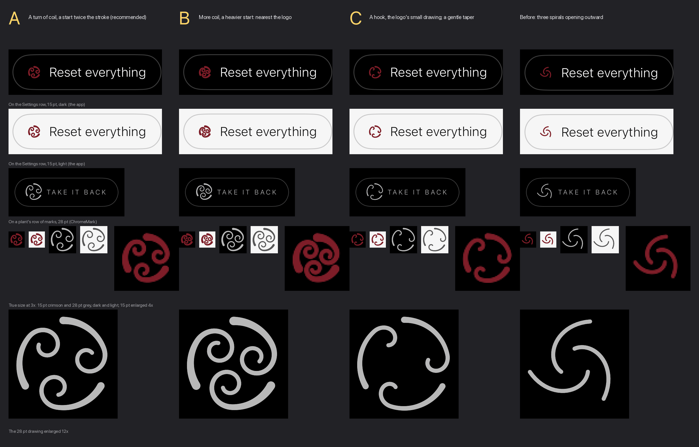

# The recycling glyph in the new logo's hand — 11 October 2026

Marcus: *"fix the recycling glyph to match the new logo".* Branch
`claude/launch-glyph-2026-10-11`; nothing is merged.

**Decided — Marcus, 11 October 2026: A**, a turn of coil and a start almost twice the
stroke. Recorded under the question at the end.



**[`choice.png`](choice.png)**, which Marcus decided from. Each column is one frond: on the Settings row
in the app, in dark and light (simulator screenshots); in a plant's row of marks; at its
true sizes on both grounds at a phone's 3× pixels, with the 15 pt one enlarged 4× to show
those pixels; and the 28 pt drawing enlarged 12×. The last column is the glyph as it was.

## Where it is drawn

| Where | Size | Ink |
| --- | --- | --- |
| Settings, *Reset everything* (`SettingsView`, `HoldToConfirm`) | 15 pt | `Chrome.crimson`, and `Chrome.ink` once the hold's fill passes under it |
| A plant's row of marks, *Take it back*, for a plant standing in the web garden (`PlantDetailView`, `ChromeMark`) | 28 pt in a 48 pt circle | `Chrome.muted` |

Both stroke the glyph with `Chrome.monoline`, 1.2 pt, in their own ink. Neither caller
changed.

## What it is now

Three of the logo's second frond round a circle (`CycleGlyph` in `Chrome.swift`). Each
starts thick on the circle, runs a third of the way round it clockwise, and winds inward
into a coil just short of where the next one starts, so the three read as one turning.
The coil is the logo's: a logarithmic spiral entered on the line's own heading
(`make_icon.py`'s `curl()`), and the thinning is the logo's ease-out, the band falling as
(1 − u)^2.5 along the frond (`TENDRIL_EASE`). Curves only: the sides are Catmull–Rom
splines, as the logo's are, and each outline closes on its own first point.

**The taper is drawn with the chrome's own pen.** A stroke cannot vary in width, and every
caller strokes the glyph with the 1.2 pt monoline. So each frond is the outline of a band,
widest at the start and nothing at the tip, and the caller's stroke round that outline is
the line: 1.2 pt plus the band at the start, exactly 1.2 pt at the tip. The thinnest point
is the hairline every other glyph is drawn in, so it never falls under a pixel, which is
what keeps the logo's own 16–48 px drawings untapered (§3.2a(5)). The ink is the caller's,
unchanged.

## The three, as drawn for the choice

Measured at 15 pt, the smallest size it is drawn: the tightest gap between two parts of the
drawing that are not neighbours along one line (a coil and the turn outside it, or a coil and
the next frond's start), with each line at its full width. A device pixel on a 3× phone is
0.33 pt.

| | Coil | Start → tip | Tip ÷ start | Tightest gap at 15 pt | at 28 pt |
| --- | --- | --- | --- | --- | --- |
| **A**, recommended | 0.95 turn | 2.2 → 1.2 pt | 0.55 | 0.49 pt | 1.7 pt |
| **B** | 1.2 turns | 2.5 → 1.2 pt | 0.48 | 0.29 pt | 1.6 pt |
| **C** | 0.62 turn, a hook | 1.8 → 1.2 pt | 0.67 | 0.88 pt | 1.8 pt |
| The logo | 1.35 turns | | 0.42 | | |

- **A** reads as three fiddleheads turning, at both sizes, with a pixel and a half between
  its turns at 15 pt. It is the heaviest glyph on the Settings row by its thick starts, and
  that is the taper Marcus asked for.
- **B** is the nearest this pen can draw to the logo: more coil and a heavier start. At 15 pt
  its inner turn comes within 0.29 pt of the turn outside it, under a pixel, and the coils
  start to read as knots. The logo's own 1.35 turns do not fit at 15 pt at all: with a tip no
  finer than the stroke, the turns merge (searched, not guessed: no circle, coil size or
  start brought 1.35 turns above 0.3 pt).
- **C** is the logo's small drawing, a hook of 0.62 turns, with Pfish's gentle taper. The
  most open at 15 pt, and the least like a coil: three crooks.

**A is now the only frond in the code**, as `CycleGlyph.Frond.chosen`; B, C and the debug
switch between them were removed once Marcus chose. The struct's dials stay, so either is a
one-line change, with these values (arc in radians; coil turns, then the radius of
curvature it enters and ends at, in units of the circle's radius; band in points; ease the
logo's ease-out exponent):

| | arc | turns | entry | eye | band | ease |
| --- | --- | --- | --- | --- | --- | --- |
| **A**, chosen | 1.2 | 0.95 | 0.44 | 0.16 | 1.0 | 2.5 |
| B | 1.1 | 1.2 | 0.52 | 0.153 | 1.3 | 2.5 |
| C | 1.35 | 0.62 | 0.36 | 0.13 | 0.6 | 2.5 |

B's band is wider than the stroke, so `CycleGlyph` strokes a centreline inside it too;
that code stays, for the same reason.

## Decision for Marcus

1. **Which frond?** A, a turn of coil and a start twice the stroke (recommended) ·
   B, more coil and a heavier start, crowded at 15 pt · C, the logo's small-drawing hook.
   **Decided, 11 October 2026: A.**

## Tests

`CycleGlyphTests`, five tests and one picture writer, now on A alone: curves only, with
each outline closing where it began; inside its box with its stroke, and filling it; each
frond thinning one way to the hairline; the three one turning (each the last turned a third
of the way round); and the gaps above held at 15 and 28 pt. Settings and the plant's row are
otherwise untouched, and nothing else draws the glyph.

## Making the picture again

```
TEST_RUNNER_PG_RENDER_CYCLE=/some/renders xcodebuild test -project PeaceGarden.xcodeproj \
  -scheme PeaceGarden -destination 'platform=iOS Simulator,id=<a scratch simulator>' \
  -only-testing:PeaceGardenTests/CycleGlyphTests/testWriteTheCycleGlyphs
python3 design/recycle-glyph-2026-10-11/make-choice.py /some/renders /some/screenshots
```

`choice.png` was made this way at commit `6342216`, when B, C and `-pgCycleFrond` were still
in the code; the picture writer now draws A and the old glyph alone. The screenshots are
Settings on a scratch iPhone Air simulator, scrolled to *Starting
again*: `-pgOpen settings -pgCycleFrond <x> -stage.appearance.v1 <dark|light>`, and the old
glyph from the build before the change. The plant's row is drawn by `ChromeMark` in the
test rather than captured, because a plant standing in the web garden is not something a
fresh simulator has. The old glyph's drawings come from a copy of its code kept in the test
file for this picture alone.
