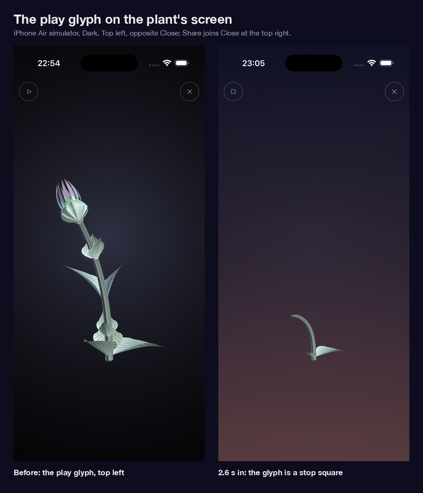
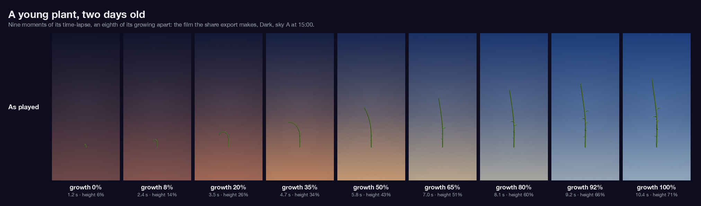
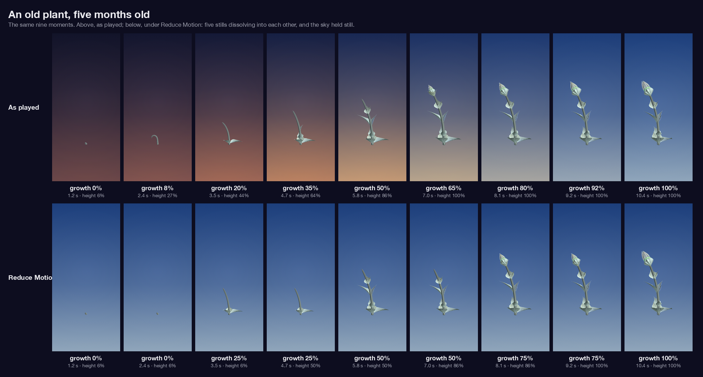
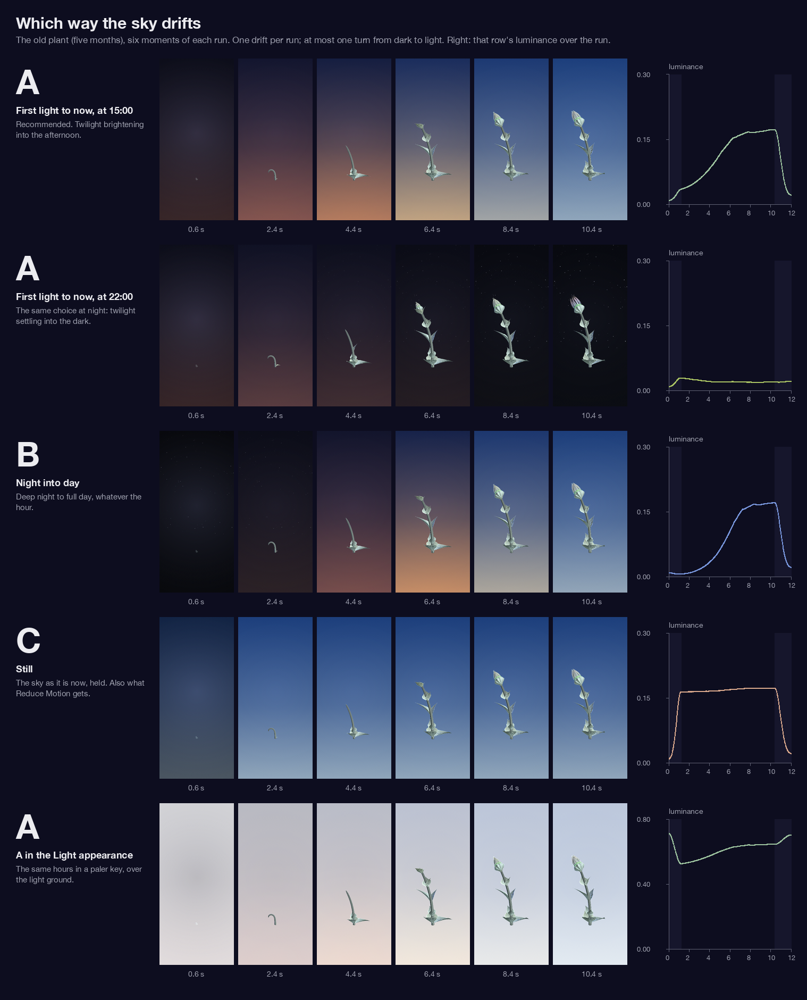
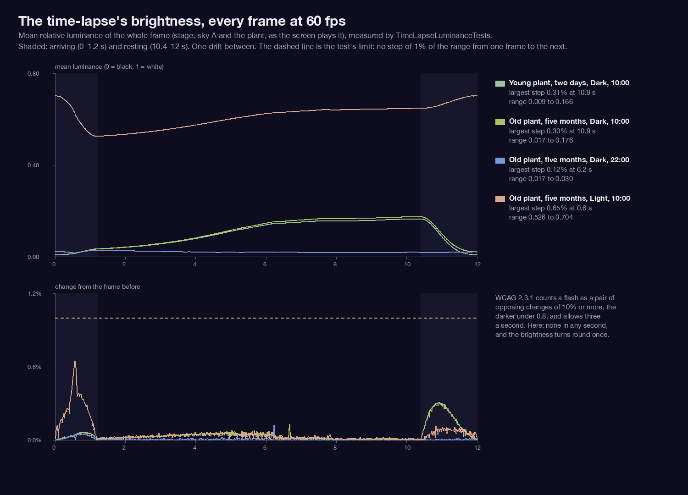

# The time-lapse — 13 October 2026

Marcus, 13 October: *"any way we can give the user the experience of seeing their plant grow
again to its current size like a time-lapse? That would be beautiful and maybe even emotional
for some..."* He chose **1A** (a play glyph on the plant's screen plays it in place, and *Share
time-lapse* goes in the new Share menu), **2A** (the same calm length for every plant, about
twelve seconds), and **3A** with a condition: the sky turns behind it as it grows, *"but not one
revolution per day as it will flash too fast, just a notion of the sky turning with time so no
one gets strobe epilepsy from it!"*

Branch `claude/time-lapse-2026-10-13`. The in-place playback is built; *Share time-lapse* is for
the Share branch to add once both are merged (see [For the share export](#for-the-share-export)).
Nothing is merged.



## How it plays

- **The glyph is top left**, opposite Close. The top right is Close and, with the Share branch,
  Share; the foot is the row of marks, which comes and goes with the words. The top left is the
  one corner nothing stands in, and the glyph is always there, as Close is. It is drawn as Close
  is drawn: a system glyph (`play`), light, in the same hairline ring, so the two corners read as
  a pair. VoiceOver: *Play time-lapse*.
- **A tap plays it in place.** The words go down if they were up; the plant as it is fades out
  over 0.6 s, the sprout fades in, and the sky comes over the stage.
- **Twelve seconds, every plant** (2A): 1.2 s arriving, 9.2 s growing, 1.6 s resting while the
  sky leaves. It ends on the plant exactly as it is now — the last frame is the live plant field
  for field, so handing back is a swap of two identical meshes.
- **While it plays the triangle is a square** (VoiceOver: *Stop time-lapse*). A tap on it, or a
  tap or swipe anywhere on the plant, stops it: the replay fades, the plant as it is fades back,
  and the sky leaves over 1.4 s — as gently as the run's own ending. **A replay is another tap.**
- **The camera holds still.** While it plays, the aim is held on the plant as it is now, so the
  sprout grows up into it from the same foot, on the same turntable, still turning.
- **Haptic: none.** A time-lapse is watched; a tick at the end would pull the eye from the plant
  to the hand, on every replay. (Question 3.)
- **Reduce Motion: the sky holds still and the growth is five stills**, at 0, ¼, ½, ¾ and all of
  the growing, each held and dissolving into the next over 0.7 s. Fades are not motion, so the
  sky still arrives and leaves. (Question 4.) The second row of `strip-old.png`.

## How the growth is timed: steady growing





Growth is front-loaded: height is an ease-out over the first weeks (`GrowthModel`'s exponent
2.4), so a run spaced evenly in days would spend its first second shooting up and the rest on a
plant that barely moves; for a plant some months old the whole of its growing would be over in a
blink. **The run is spaced by how much the plant visibly changes**: the life is sampled finely
from the first sprouting to now, each step weighted by what the eye takes in (height most, then
leaves and flowers opening, then the buds and the flowering cycle), and the frames are placed so
every second shows the same amount of growing — the way a time-lapse photographer drops frames in
the quiet stretches. Over that, **half linear, half smoothstep**: the sprout starts at half speed
and the plant settles into its last frame rather than stopping on it. No second of the growing
holds more than a fifth of it (tested; even would be a ninth).

Two things are held still, because replayed on the calendar they would flicker:

- **The hour.** Petals open by day and close at night, so a replay on the calendar opens and
  shuts them every simulated day — ten times a second for a plant a hundred days old. Every frame
  is read at the hour it is now (the same calendar door `Maturity.bloomPreview` uses), so the
  flowers open once.
- **The flowering cycle.** A mature plant's band of open flowers travels up it over a week or a
  month. Its phase is held at today's, and its depth rises as the buds swell, so every bud swells
  and every flower opens once, straight to how it is today — never open and then closing into
  the present.

Every frame is a genuine render of the plant's own genome at that moment (`PlantBuilder`), not a
scaled copy. No seed string, name or date is shown.

## The sky



**A — first light to now** is built. The sky starts at first light (the sun four degrees under
the horizon: a deep blue overhead, rose and mauve low down) and drifts once to the sky as it is at
this hour: brightening into the day if it is day, settling into the dark, with the stars coming
out, if it is night. It ends on the real sky of the moment. The colours are the garden's own:
day from `SkyPalette`, the keyframes chosen on 2 October, on the sun's arc (`SunPath`); night from
the garden's night sky.

- **One drift, re-timed like the growth.** Spaced by the sun's height, nearly all the visible
  change is in twilight and was over in two seconds. The drift is spaced by how much the sky
  visibly changes instead, so it is spread across the whole of the growing.
- **No horizon.** A pale band across the middle with darker air under it was a ground line by
  another name, and the plant stood on it. The sky grades one way, zenith at the top to its
  palest at the foot of the glass, and the sun's warmth rises from below the edge.
- **Fixed stars**, ninety, from a fixed seed. They come out as the sky darkens and fade as it
  lightens. They do not twinkle and they do not move.
- **Held under the plant**: over black the sky is at 80% (the stage's pool of light still shows
  through); in the Light appearance it is the same hours taken 70% of the way to the light
  ground (bottom row above).

### Measured: no flashing



`TimeLapseLuminanceTests` draws every frame at 60 fps and measures its mean relative luminance
(sRGB linearised, 0.2126 R + 0.7152 G + 0.0722 B), and holds three things:

1. **No step of 1% of the full range or more between two frames** — half the 2% suggested.
2. **The brightness turns round at most once** in the run (wiggles under 1% not counted).
3. **No WCAG 2.3.1 flash inside any second** (a pair of opposing changes of 10% or more, the
   darker under 0.8). WCAG allows three a second; this allows none.

Swept over all three drifts, both appearances, every second hour of the day, Reduce Motion, and
stops at 3, 6 and 9 seconds (74 runs and 54 stops); then the whole frame — stage, sky A and the
growing plant, as the screen plays it, opening on the plant as it is — for a young and an old plant.

| Run | Largest step between frames | Turns |
| --- | --- | --- |
| Sky over the stage, Dark, worst of all runs (arriving into a noon sky) | 0.42% | 1 |
| Sky over the stage, Light, worst of all runs and stops (a stop part way through) | 0.58% | 1 |
| Whole frame, young plant, Dark, 10:00 | 0.31% | 1 |
| Whole frame, old plant, Dark, 10:00 | 0.30% | 1 |
| Whole frame, old plant, Dark, 22:00 | 0.12% | 1 |
| Whole frame, old plant, Light, 10:00 | 0.65% | 1 |

The largest steps are the arriving and the leaving, not the drift. In the Light appearance the
arriving is the biggest change in the run — the light ground darkening to first light — at 0.65%
a frame.

## Smooth enough? Measured

Every plant shown is built live, off the main thread, for the moment it will be shown at, by up
to three builders side by side (one fewer than the phone's cores). The sky is a gradient and
moves every frame. On the iPhone Air simulator, **Debug build**, the old plant's run drew 557
frames and **46 new plants a second while growing, the longest wait between two plants 13 ms**
(the simulator was drawing about 46 frames a second itself). One plant took 2.6 to 27 ms to
build across four test genomes, the heaviest (25 000 vertices) up to 55 ms, which is why there
are three builders. A Release build on a phone is several times faster; **the phone is the test
still to do** — a Debug build prints `TIME-LAPSE PLAYED: …` to the console at the end of each run.

## For the share export

`TimeLapseFilm` (`Views/TimeLapse/TimeLapseFilm.swift`), the same score and renderer:

```swift
// A 12 s H.264 movie, 1080 × 1920, 30 fps, Dark, sky A, no words:
try await TimeLapseFilm.writeMovie(record, now: model.now, to: url)

// Or every frame, for a pipeline of its own:
try await TimeLapseFilm.render(record, now: model.now, options: options) { frame in
    // frame.index, frame.time, frame.progress (0…1 of the growing), frame.image (CGImage)
}
```

`TimeLapseFilm.Options`: `size` (pixels), `fps`, `drift`, `scheme` (Dark by default whatever the
phone's appearance: a film is watched somewhere else), `reduceMotion`, `opensOnThePlant` (off: a
film starts on the sprout; on: as the screen does), `turns` (the stage's turntable), `calendar`.
The film is the stage, the sky and the plant, framed as the plant's screen frames it. Nothing in
it knows about sharing.

## Strings

Two keys, both VoiceOver labels — the glyph is the system's, so nothing is drawn in words.

| Language | Play | Stop | State |
| --- | --- | --- | --- |
| English | Play time-lapse | Stop time-lapse | source |
| Danish | **Afspil time-lapse** | **Stop time-lapse** | translated |
| Spanish | Reproducir time-lapse | Detener time-lapse | needs review |
| French | Lire l’accéléré | Arrêter l’accéléré | needs review |
| Italian | Riproduci time-lapse | Interrompi time-lapse | needs review |
| Norwegian | Spill av time-lapse | Stopp time-lapse | needs review |
| Dutch | Speel time-lapse af | Stop time-lapse | needs review |
| Swedish | Spela upp time-lapse | Stoppa time-lapse | needs review |

*Time-lapse* follows what the Camera app calls the mode in each language (*Accéléré* in French).
Added by hand in Xcode's layout; `tools/strings/check.py` and `tools/strings/app_check.py` clean.

## Decisions for Marcus

**1. Which way the sky drifts?** (`sky-ABC.png`)
- **A — first light to now.** *Recommended, built.* It ends on the real sky of the moment, so the
  plant arrives at now under now; by day it brightens, at night it settles into the dark.
- **B — night into day.** Always deep night to full day, whatever the hour. The most "time
  passing" of the three, but it ends on a day sky at midnight.
- **C — still.** The sky as it is now, held. Calmest; no sense of time turning.

**2. Where the play glyph goes?** (`plant-screen.png`)
- **A — top left, opposite Close.** *Recommended, built.* Always there, one touch, clear of Share.
- **B — at the plant's foot, bottom centre**, shown only while the words are down (the row of
  marks takes the foot when they are up).
- **C — in the row of marks**, as a mark: only when the words are up, and two touches (word,
  then play).

**3. A haptic at the end?**
- **A — none.** *Recommended, built.*
- **B — one soft tick** as the plant arrives at now.

**4. Reduce Motion?** (`strip-old.png`, second row)
- **A — five stills dissolving, the sky held still.** *Recommended, built.*
- **B — one dissolve**, from the sprout to the plant as it is, over the same twelve seconds.
- **C — no time-lapse under Reduce Motion**: the glyph is not shown.

**5. The Light appearance?** (`sky-ABC.png`, bottom row)
- **A — the same hours in a paler key** over the light ground. *Recommended, built.* Its arriving
  is the largest step in the run, 0.65% a frame, inside the limit.
- **B — the Dark sky in both appearances**: the screen goes dark for the twelve seconds. Truer
  colours, but a white screen darkening to first light; not built, and would need measuring.

**6. Does the shared film open on the plant as it is?**
- **A — no, it starts on the sprout.** *Recommended, the default.* A film is watched cold; the
  sprout is the beginning.
- **B — yes, as the screen does**: the grown plant, fading, then the sprout (`opensOnThePlant`).

## Files

- `App/PeaceGarden/Views/TimeLapse/` — new: `TimeLapse.swift` (the score), `TimeLapseSky.swift`
  (the sky, its colours, and `TimeLapseLuminance`), `TimeLapsePlayer.swift` (in place),
  `TimeLapseNodes.swift` (genuine meshes, off the main thread), `TimeLapseButton.swift` (the
  glyph, the sky layer, the stop catcher), `TimeLapseFilm.swift` (frames and movie).
- `App/PeaceGarden/Views/PlantDetailView.swift` — the glyph, the sky layer, the stop catcher,
  the player handed to the scene, and a cancel when the screen goes or the chevrons step.
- `App/PeaceGarden/Rendering/PlantSceneView.swift` — a `timeLapse` parameter, a node on the
  turntable for the replay, the live plant's opacity, and the aim held during a run.
- `App/PeaceGarden/Resources/Localizable.xcstrings` — the two keys.
- `App/PeaceGardenTests/TimeLapseTests.swift`, `TimeLapseLuminanceTests.swift`,
  `TimeLapseRenderTests.swift` (pictures, skipped unless `PG_RENDER_TIMELAPSE` is set).
- `design/time-lapse-2026-10-13/compose.py` — lays out these pictures from the frames the tests
  draw; the command is at its head.

## Tests

- `TimeLapseTests` (5): twelve seconds whatever the age, from 15 minutes to 400 days; the growth
  from the sprout (height's floor, no leaves, no bud) to the live plant field for field, never
  back in any field the mesh is drawn from, flowers included; no second holding a fifth of the
  growing; every moment read at the hour it is now; Reduce Motion's still sky and five stills.
- `TimeLapseLuminanceTests` (2): above.

Run on a scratch iPhone Air simulator (iOS 26.5) with `GardenControlsTests` (9) and `PlotTests`
(47): **63 tests, 0 failures**. The full suite was not run.
