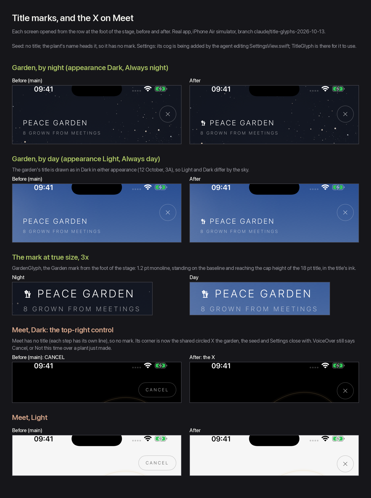
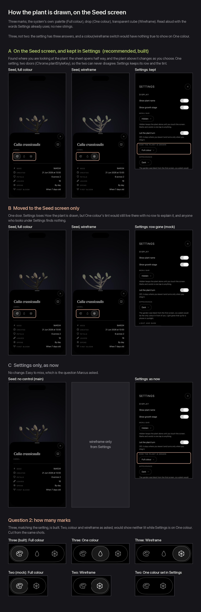

# Title marks, the X on Meet, and how the plant is drawn on the Seed screen — 13 October 2026

Marcus, 13 October:

> show the glyphs from the lower menu next to each title on the screens they open, so the cog
> next to Settings, the garden next to Peace Garden, etc.
> I'm also wondering if we should have a quick plant colour / wireframe toggle on the Seed
> modal, as the user may not think to look under Settings

and later the same day:

> the top right button on the MEET screen needs to be a X in a circle like the Settings and
> Garden screens have. Consistency.

Branch `claude/title-glyphs-2026-10-13`; nothing is merged. Every picture is the real app on an
iPhone Air simulator over a garden of eight plants; *before* is `main` built from the same
commit the branch starts at.

## 1. The mark beside each title (built)

The row at the foot of the stage, and what each mark opens:

| Mark | Drawing | Opens | Its title | Mark beside the title |
| --- | --- | --- | --- | --- |
| Seed | `SeedGlyph` | `SeedView`, a sheet | none: the plant's name heads it | none |
| Meet | `MeetGlyph` | `ExchangeView`, full screen | none: each step has its own line (*Where you meet*, *Looking for someone nearby*…) | none |
| Garden | `GardenGlyph` | `GardenView` → `PlotView` (or `GardenGridView` behind the developer switch) | PEACE GARDEN | **`GardenGlyph`, built** |
| Settings | `CogShape` | `SettingsView`, a layer that rises | SETTINGS | the cog, added by the agent editing `SettingsView.swift` |

`TitleGlyph` and `titleGlyph(_:size:)` in `Chrome.swift` are the one piece: the same `Shape`,
stroked with `Chrome.monoline` (1.2 pt, as in the row), in a frame from the baseline to the
title's cap height plus the 0.9 pt every mark keeps inside its box for its stroke, in the
title's own foreground style, silent to VoiceOver, and pinned to the hand it was drawn with.
Under right-to-left the mark still stands before the title, which is then on its right. For
Settings it is `Text("Settings").chromeHeading().titleGlyph(CogShape(), size: 20)`.

The garden stands on the baseline and its flower reaches the top of the capitals. At 18 pt
that frame is 14.5 pt, just under the 15 pt `CHROME-AND-SETTINGS.md` records as the floor the
small marks were drawn to survive; the flower's five lobes close up a little, and it still
reads as a flower beside grass.

## 2. The X on Meet (built)

Meet's top-right control was the word **CANCEL** in a capsule (**NOT THIS TIME** over a plant
just made). It is now `CloseButton`, the circled X the garden, the seed and Settings already
close with, in the same corner at the same 12 pt inset as the garden's. It does what it did:
`dismiss()`, which stops the search (`onDisappear`) and, over a plant just made, leaves it
unkept. VoiceOver still reads *Cancel* or *Not this time*, because the system symbol alone
would say only *Close*, and the second of those is the one place where closing means
something more. No new strings; the two existing ones are now VoiceOver labels and their
catalogue comments say so.

The other screens behind the row already close with it: Seed (and *What the name means*
from it), the garden (and a plant's own screen from it), Settings, and *They don't have the
app* inside Meet. Meet was the only one.

## 3. How the plant is drawn, on the Seed screen

The setting is **How the plant is drawn** in Settings' Display section: *Full colour*, *One
colour* or *Wireframe*, stored at `Chrome.plantStyleKey` (`stage.plantStyle.v1`) and read by
the stage (`PlantStageView` → `PlantSceneView`). The tint for the two single-colour styles is
`Chrome.plantTintKey`, in Settings only.

**A is recommended, and is what the branch builds**: three marks in one capsule on the Seed
screen, under the plant's name, bound to the same key, and Settings keeps its row.

- **Discoverable where you look at the plant.** The Seed sheet opens half way, so the plant
  it changes is standing just above it, and the change is seen as it is made.
- **One setting, two doors, no conflict.** Both read and write `Chrome.plantStyleKey`; there
  is nothing to keep in step and no way for the two to disagree.
  `PlantDrawingToggleTests` hosts the Seed control and checks it writes that key and shows
  whatever is in it.
- **Settings still has it**, for anyone who looks there, beside the tint it governs.

B moves it to the Seed screen alone, which leaves the tint in Settings with no row above it
saying what it tints. C is today, and is the thing Marcus asked about.

The marks are the system's own (`StagePlantStyle.symbol`): `paintpalette` for Full colour,
`drop` for One colour, `cube.transparent` for Wireframe, at the light weight of the X. The
capsule is the Light row's control from Settings (`LightToggle`), lifted out generic as
`MarkChooser`, so the two look and behave alike. VoiceOver reads the question and each answer
in the words Settings already uses. No new strings.

**Three marks, though the ask was colour or wireframe**: the setting has three answers, and a
two-mark switch would have nothing true to show while Settings is on *One colour*.

## For Marcus

1. **The Seed screen's control** — **A** on the Seed screen and kept in Settings (built) ·
   **B** Seed screen only · **C** Settings only, as now. The three rows of
   `seed-toggle-ABC.png`.
2. **How many marks** — **A** three, matching the setting (built) · **B** two, Full colour and
   Wireframe, with One colour left to Settings and neither mark lit while it is chosen. The
   strip at the foot of `seed-toggle-ABC.png`; B there is cut from the A shots, not built.

## Checks

`tools/strings/check.py` and `tools/strings/app_check.py` clean.
`PlantDrawingToggleTests` (4), `GardenControlsTests` (9) and `PlotTests` (47): 60 tests, none
failing.
