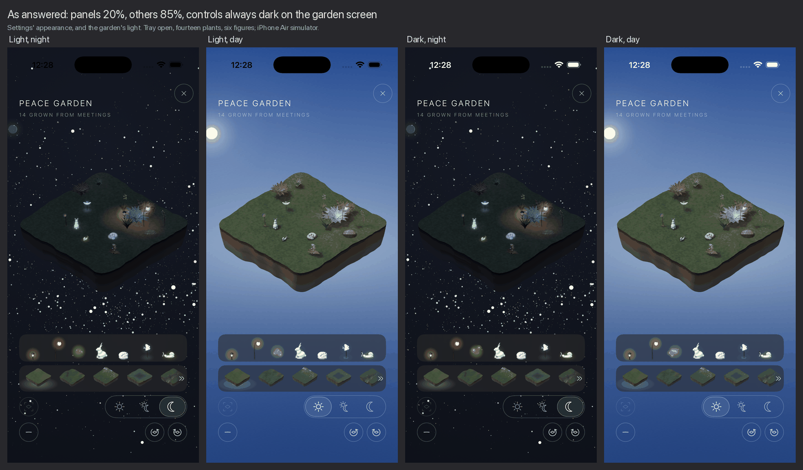
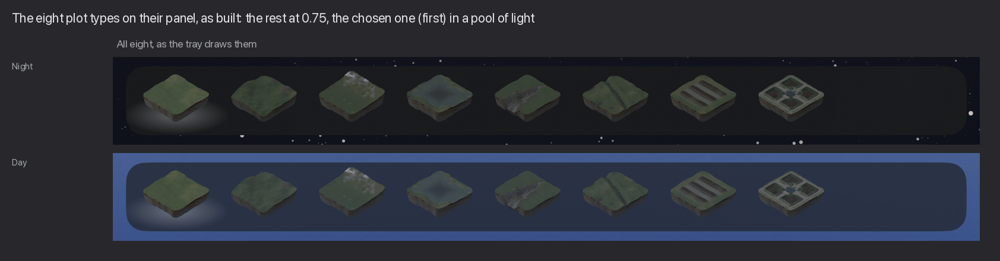
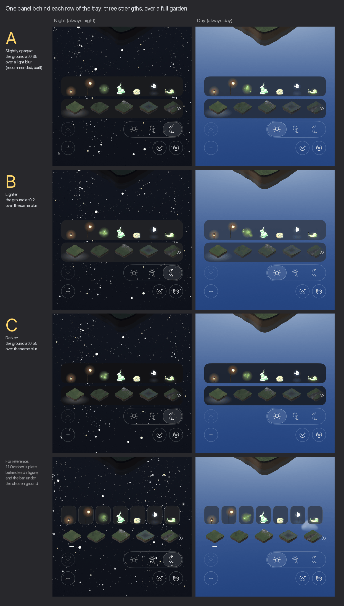
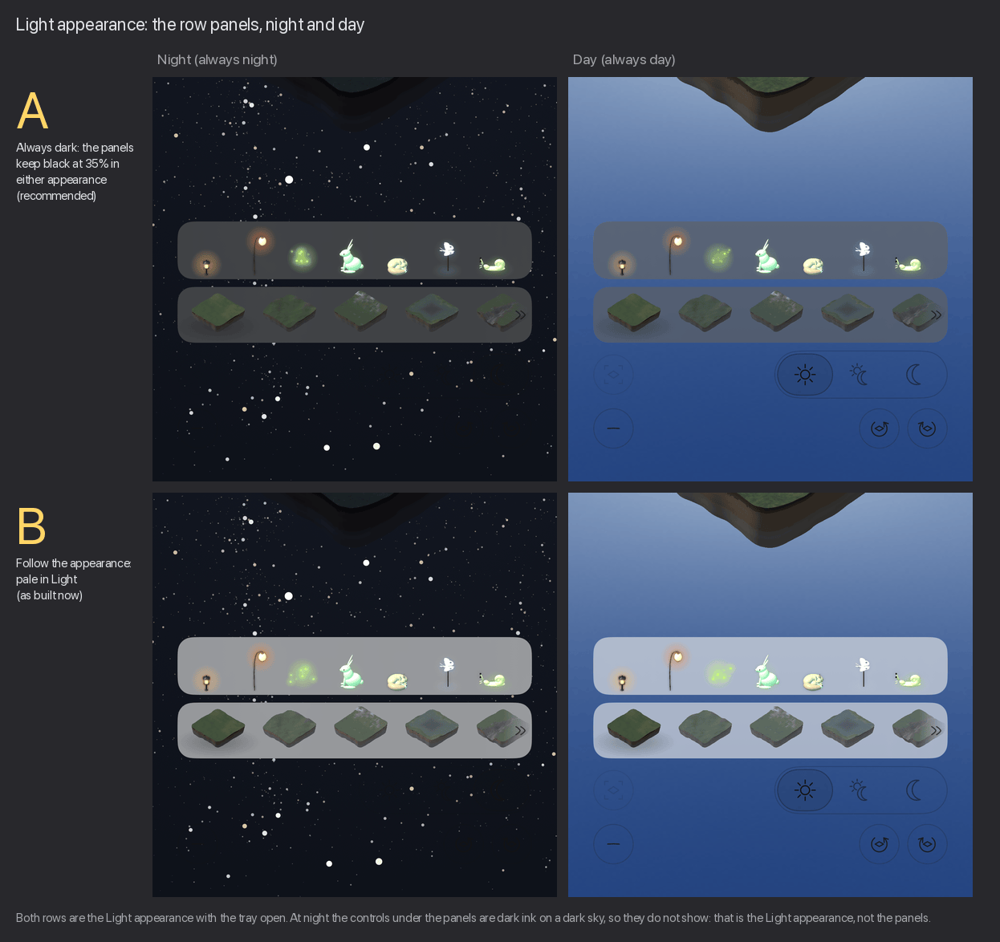

# The tray's panels — 12 October 2026

Marcus's answers to the 11 October pictures (`../garden-controls-2026-10-11/`), built, and one
fix to the update check. Branch `claude/tray-panels-2026-10-12`; nothing is merged.

**Answered 12 October** (Marcus: *1B 2B (the 7 others at 85%) 3A*), built on
`claude/tray-answers-2026-10-12`:

- **1B, lighter panels.** The row panels are darkened 20%, not 35%, over the same thin blur
  (`ContinuingRow.shade`, 0.20).
- **2B, the plot types not chosen at 0.85**, not 0.75 (`GroundMark.others`). The chosen one keeps
  its soft pool of light.
- **3A, the garden screen's controls always as in Dark**, whichever appearance is chosen in
  Settings (`PlotView.scheme`). The title, the row at the foot, the tray and its panels, a light's
  panel and Close are drawn as in Dark; under *Light* at night the foot row and the title had
  vanished into the sky. The garden itself is drawn as before, and every other screen follows the
  appearance — including what the garden presents (a plant's own screen, the answer to an
  asking), which stands on its own ground rather than over the sky.

The real app on an iPhone Air simulator, tray open, over a full garden (fourteen plants, six
figures). Below the status bar the Light frames match the Dark ones, apart from what moves (the
fireflies, the stars' twinkle). **The status bar is the one thing left that follows the
appearance**: the time, signal and battery along the top are the phone's own, drawn dark under
*Light*, so at night they are faint. The app hides the status bar on its first screen, and the
garden, which is presented over it, shows it; hiding it on the garden too would settle it.

The questions below are kept as they were asked.

Every picture is the real app on an iPhone Air simulator with a full garden (fourteen plants,
six figures), at night (*Always night*) and by day (*Always day*).

## What changed

**1. One panel behind each row, not a plate behind each figure.** One slightly opaque panel
behind the whole row of figures, and one behind the whole row of plot types. Each is a single
rounded rectangle inside the screen's margins, the same for everything in the row and wherever
the row has been scrolled to. The sky behind it is blurred, which takes the stars and clouds
out from behind the row, and darkened a little with the screen's own background colour. The row scrolls
inside its panel and fades at the panel's ends, and the double chevron stands just inside the
panel's edge. The plates, their three options and `-pgPlate` are gone; `PlotTray.swift` is
105 lines shorter (349 to 244).

**2. The plot types: Marcus's B, with C's pool of light.** The ones not chosen stand at 0.75
(0.42 before 11 October, full strength since); the chosen one is at full strength in a soft
pool of light. VoiceOver still reads *selected* on it. The bar, the other options and
`-pgGrounds` are gone; one constant, `GroundMark.others`, holds the 0.75.

**3. *Reset view*.** VoiceOver now says *Reset view* for the mark in the tray, instead of a
system symbol's name, and every comment, test and doc that names the control says
*Reset view*. It was not a string before, so it is one new key in `Localizable.xcstrings`:

| Language | Text | State |
| --- | --- | --- |
| Danish | **Nulstil visning** | translated |
| Spanish | Restablecer vista | needs review |
| French | Réinitialiser la vue | needs review |
| Italian | Reimposta vista | needs review |
| Norwegian | Nullstill visning | needs review |
| Dutch | Weergave herstellen | needs review |
| Swedish | Återställ vyn | needs review |

The Danish follows the catalogue's own words: *Nulstil* as in *Nulstil alt*, *Visning* as in
*Display*. The others are drafts on the same pattern, flagged for the next translation round.

**4. Kosovo in the update check.** Apple's storefront code for Kosovo, `XKS`, is not ISO's, so
the conversion refused it and phones in Kosovo skipped the check. One alias, `XKS` to `xk`, is
read before Foundation is asked. Still never the US store.

## Decision for Marcus

**How strong should the panels be?**

- **A** — darkened 35% over a light blur. *Recommended, built.* By day the rows read as two
  darker bands of sky without becoming slabs.
- **B** — darkened 20%. By day the panels come close to melting into the sky.
- **C** — darkened 55%. The strongest contrast, and by day two heavy dark bars across the foot
  of the sky.

At night the three look much alike: the night sky is nearly as dark as the panel, and the blur,
which takes the stars out from behind the rows, does the work. The last row, unlettered, is
11 October's plate behind each figure, for reference.

To change it, change `ContinuingRow.shade` in `App/PeaceGarden/Views/PlotTray.swift`.

## Light appearance

**Should the panels follow Settings' *Light* appearance?** The pictures above are the default,
*Dark*. Under *Light* the panel's fill, `Chrome.ground`, is near-white, so the panels become a
pale veil over the garden's night or day sky.

- **A** — *Always dark*: the panels keep black at 35% in either appearance. *Recommended.* The
  panel exists for contrast against the garden's own sky, and the sky does not change with the
  appearance: the figures' glows and the pale figures (the moth, the rabbit, the snail) stand on
  a dark panel as they do in *Dark*, by night and by day.
- **B** — *Follow the appearance*: pale in *Light*. *As built now.* Dark ink has a pale panel to
  stand on, but the figures lose it: the green glows, the white moth and the pale rabbit sit
  light on light, at night as much as by day.

Both are the real app on an iPhone Air simulator with *Light* set, tray open, over the same full
garden. A is made by changing the panel fill to `Color.black.opacity(Self.shade)` in
`ContinuingRow`; that change is not committed. Two things it leaves, if A is chosen: the blur
under the fill is the system's material, which is lighter in *Light* than in *Dark*, so the panel
reads as a mid grey and not as dark as the pictures above; and the double chevron is drawn in
the appearance's own ink, which is dark in *Light*, so on a dark panel it is faint. Pinning the
whole row to the dark appearance is the way to settle both; not tried here.

## Not asked, worth knowing

- **The blur is cheap here.** Two of the system's thinnest blur, where 11 October had seven
  plates each with its own. The night sky behind them is still, and the day sky's clouds
  redraw at most twelve times a second.
- **Under Settings' *Light* appearance the panels are pale, not dark.** They are shaded with the
  screen's own ground, which is near-white in that appearance, so the ink on them still has
  something to stand against. Photographed under *Light appearance* above; the other pictures
  are the default, *Dark*.
- **The app's string catalogue is behind its source on `main`.** Syncing it after a build
  (`tools/strings/sync.sh`) would also bring in about twenty keys from other work (the public
  website garden's wording, the Wild Fields messages) and mark several stale. Only *Reset
  view* was added here, by hand, in Xcode's own layout; the rest is for whoever owns that work.
- **Debug flags.** `-pgTray YES` still opens the tray on launch. `-pgPlate` and `-pgGrounds`
  went with the options they chose between.

## Tests

- `GardenControlsTests` now also reads what VoiceOver says for the tray's reset mark and
  expects *Reset view*.
- `GardenControlsRenderTests` draws the plot-type row as built, at night and by day, for
  `grounds.png` (skipped unless `PG_RENDERS` is set).
- `UpdateCheckTests.testKosovosStorefrontAsksKosovosStore`: `XKS` and `xks` give `xk`, and the
  check asks in `country=xk`. `XKX`, which is not Apple's code, is still refused.

`panels-ABC.png` is three builds of the app differing only in `ContinuingRow.shade`, each
photographed on the simulator; the reference row is 11 October's photographs of the plates.
